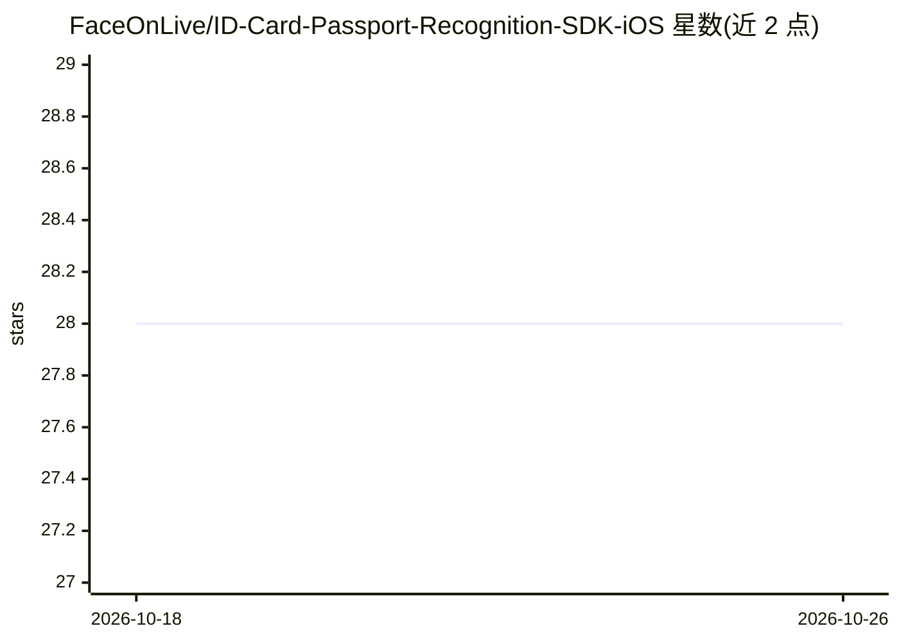

# FaceOnLive/ID-Card-Passport-Recognition-SDK-iOS

⭐ 28 · Swift · 推送 2026-07-02 · [GitHub](https://github.com/FaceOnLive/ID-Card-Passport-Recognition-SDK-iOS) · [官网](https://faceonlive.com) · 组织维护

**iOS 端证件识别 SDK：离线识别身份证/护照/驾照**

FaceOnLive 本地生物识别 SDK 套件的 iOS 组成部分：在设备上离线完成身份证、护照、驾驶证的 OCR 与 MRZ 识别，并提取人像与证件裁剪图，输出结构化 JSON。识别引擎与模型打包在 idsdk.framework 中，通过 Swift API（setActivation/initSDK/idcardRecognition）调用，需在官网申请 license key 激活，有免费试用。仓库仅含源码/演示代码，完整 SDK（引擎库与模型）需从 Releases 页下载。要求 iOS 13.0+、Xcode 14+。

## 筛选速览

| 维度 | 判定 | 备注 |
|---|---|---|
| AI 角色 | `ai-native` | 本体是模型或模型工具 |
| 许可风险 | `none` | — |
| 部署形态 | `desktop` | 安装包/桌面程序 |
| 模型依赖 | — | README 未给出锁定关系 |
| 硬件要求 | — | 无带数字的原话,不猜 |
| 安装摩擦 | `low` | 无编译、无系统依赖或容器化 |
| 成熟度 | — | 结构信号不足 |

## 能力要点

- 设备端离线识别，数据不出手机
- 提取文本字段、MRZ 与人像照片，输出结构化 JSON
- 以 Swift API 集成，含 idsdk.framework
- 完整引擎库与模型从 Releases 页下载

## 适用场景

- 在 iOS 应用中集成 eKYC 证件扫描功能
- 离线环境下识别护照与身份证 MRZ
- 提取证件人像用于后续身份核验流程

## 场景标签

`OCR` · 领域:感知与多模态

## 证据(README 行号)

> L3: On-device ID document recognition (OCR, MRZ, and portrait extraction) for iOS. Scan passports, national ID cards, an
> L8: - Extract text fields, MRZ, and the portrait photo from an ID.
> L9: - On-device and offline — no data leaves the phone.

## 星数曲线

2026-10-18 28 → 2026-10-26 28（+0）

---
*卡片 v1 · prompt 1.4 · 生成 2026-10-26 · 置信度 high · 依据 README sha `853d599e384c` · [字段定义](../../DATASET.md)*
