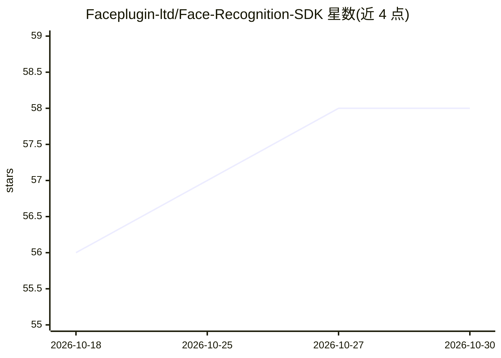

# Faceplugin-ltd/Face-Recognition-SDK

⭐ 58 · 推送 2026-09-21 · [GitHub](https://github.com/Faceplugin-ltd/Face-Recognition-SDK) · [官网](https://faceplugin.com/face-recognition/) · 组织维护

**本地化人脸识别与活体检测 SDK 产品集线器，面向 KYC/门禁**

FacePlugin 维护的商用 SDK 产品仓库（product hub）：提供人脸检测、 landmarks、姿态、属性、ICAO 风格质量评估、模板提取、1:1 比对与 1:N 识别，并配 3D 被动活体检测 SDK（宣称 iBeta Level 2 级别、防打印照片/视频回放/3D 面具/深伪）。全部处理在设备本地完成，不向云端发送生物特征数据。本体仓库不含引擎二进制（位于 Google Drive），需按平台克隆对应子仓库；Linux/Docker 镜像自带运行时，提供 REST API（detect/quality/match）。平台覆盖 Android、iOS、Windows、Linux/Docker、React Native、Flutter、.NET、Web 等 13 个。

## 筛选速览

| 维度 | 判定 | 备注 |
|---|---|---|
| AI 角色 | `ai-native` | 本体是模型或模型工具 |
| 许可风险 | `none` | — |
| 部署形态 | `self-host` | docker 或自建部署 |
| 模型依赖 | — | README 未给出锁定关系 |
| 硬件要求 | — | 无带数字的原话,不猜 |
| 安装摩擦 | `low` | 无编译、无系统依赖或容器化 |
| 成熟度 | — | 结构信号不足 |

## 能力要点

- 人脸检测/landmarks/质量/1:1 比对/1:N 识别全链路能力
- 3D 被动活体检测，处理全部在设备本地
- Docker 镜像自带运行时，提供 detect/quality/match REST API
- 13 个平台子仓库（Android/iOS/Flutter/React Native/.NET/Web 等）

## 适用场景

- 在 App 中集成 KYC 与身份核验的人脸比对
- 门禁或考勤场景做 1:N 人脸识别与活体防伪
- 服务器端通过 REST API 做人脸检测与匹配

## 场景标签

`人脸识别` · 领域:感知与多模态

## 证据(README 行号)

> L10: > **NIST FRVT**-class **face recognition SDK** with **3D passive liveness detection**. Face detection, landmarks, q
> L15: FacePlugin **Face Recognition SDK** is a fully **on-premise face recognition SDK** for KYC, access control, and ide
> L17: You get **face detection** (box, landmarks, pose, attributes), **ICAO-style face quality**, **template extraction**

## 星数曲线

2026-10-18 56 → 2026-10-30 58（+2）

---
*卡片 v1 · prompt 1.4 · 生成 2026-10-24 · 置信度 high · 依据 README sha `3ff2b30cfa20` · [字段定义](../../DATASET.md)*
