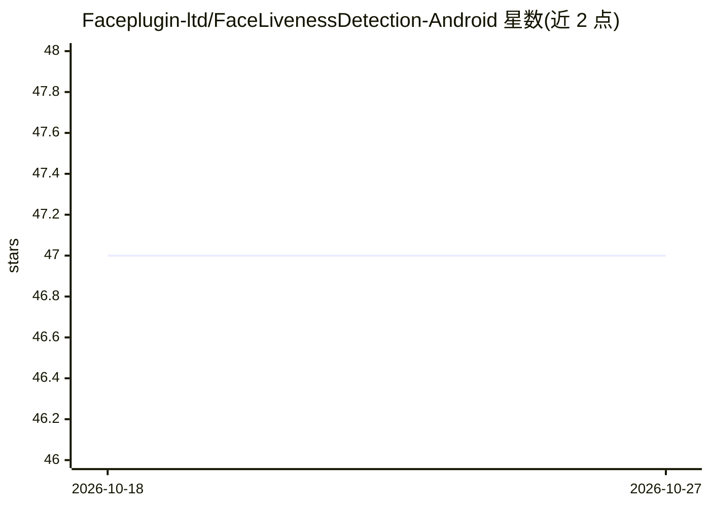

# Faceplugin-ltd/FaceLivenessDetection-Android

⭐ 47 · Kotlin · 推送 2026-10-02 · [GitHub](https://github.com/Faceplugin-ltd/FaceLivenessDetection-Android) · [官网](https://faceplugin.com/face-liveness-detection/) · 组织维护

**面向 Android 开发者的设备端人脸活体检测 SDK 演示应用**

FacePlugin 的 Android 活体检测 SDK 演示仓库：运行时为闭源 AAR（facelivenessdk.aar，需从 Google Drive 下载放入 libfacesdk/），在手机上本地执行反欺骗检测，可识别打印照片、视频回放、3D 面具与 deepfake 类攻击，全程无云端、生物特征数据不离开设备。支持前后摄像头切换与活体阈值设置，最低 Android API 24，需物理设备与离线 license（绑定 applicationId）。自有应用集成需联系厂商获取新 license。

## 筛选速览

| 维度 | 判定 | 备注 |
|---|---|---|
| AI 角色 | `ai-native` | 本体是模型或模型工具 |
| 许可风险 | `none` | — |
| 部署形态 | `None` |  |
| 模型依赖 | — | README 未给出锁定关系 |
| 硬件要求 | — | 无带数字的原话,不猜 |
| 安装摩擦 | `low` | 无编译、无系统依赖或容器化 |
| 成熟度 | — | 结构信号不足 |

## 能力要点

- 设备端反欺骗检测：打印照片/视频回放/3D 面具/deepfake 攻击
- 全程本地处理，生物特征数据不离开设备
- iBeta level 2 声明的被动活体检测（描述中标注）
- 离线 license 绑定 applicationId，含演示用可用密钥

## 适用场景

- 在 KYC 与远程身份验证流程中加入活体检测
- 在自有 Android 应用中集成人脸反欺骗能力
- 在真实手机上体验并验证活体检测效果

## 场景标签

`人脸识别` · 领域:感知与多模态

## 证据(README 行号)

> L26: FacePlugin **Face Liveness Detection SDK for Android** is a fully on-device anti-spoofing engine for KYC and remote
> L28: All processing stays on the phone. **No** biometric data leaves the device.

## 星数曲线

2026-10-18 47 → 2026-10-27 47（+0）

---
*卡片 v1 · prompt 1.4 · 生成 2026-10-25 · 置信度 high · 依据 README sha `569844967d9d` · [字段定义](../../DATASET.md)*
