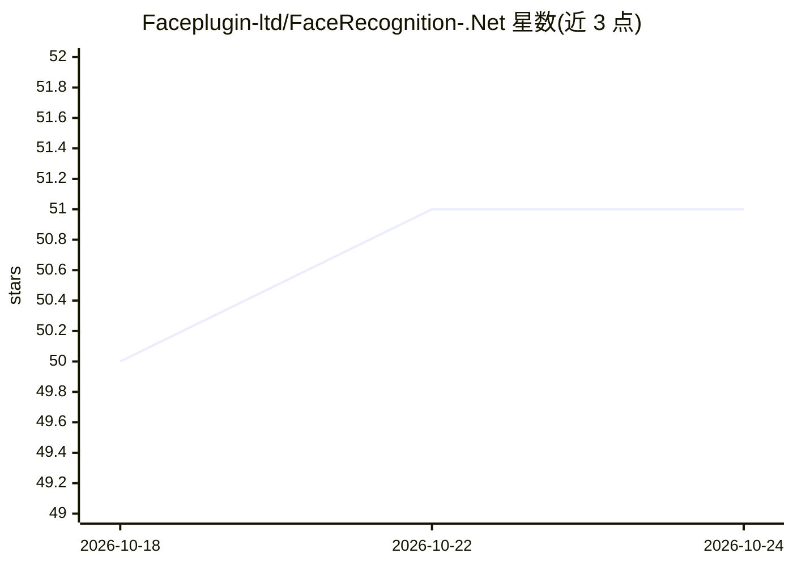

# Faceplugin-ltd/FaceRecognition-.Net

⭐ 51 · C# · 推送 2026-09-21 · [GitHub](https://github.com/Faceplugin-ltd/FaceRecognition-.Net) · [官网](https://faceplugin.com/) · 组织维护

**.NET/C# 人脸识别 SDK，含 3D 被动活体检测，本地运行**

FacePlugin 提供面向 .NET MAUI 与 C# 的人脸识别 SDK，功能覆盖人脸检测、人脸关键点、人脸识别、活体检测、姿态、表情与属性分析。README 称其识别能力在 NIST FRVT 中排名靠前，活体检测通过 iBeta level 2，可防御打印照片、视频回放、3D 面具与深度伪造。SDK 完全本地运行（on-premise），数据不出设备。支持 Windows、Android、iOS 平台。同厂商另有 Android/iOS/JS/React/Vue 等多平台人脸与活体检测产品线。README 未提供安装命令或代码示例，仅列出产品与联系方式。

## 筛选速览

| 维度 | 判定 | 备注 |
|---|---|---|
| AI 角色 | `ai-native` | 本体是模型或模型工具 |
| 许可风险 | `none` | — |
| 部署形态 | `None` |  |
| 模型依赖 | — | README 未给出锁定关系 |
| 硬件要求 | — | 无带数字的原话,不猜 |
| 安装摩擦 | `low` | 无编译、无系统依赖或容器化 |
| 成熟度 | — | 结构信号不足 |

## 能力要点

- 人脸检测、关键点、识别、活体、姿态、表情与属性分析
- 3D 被动活体检测（README 称 iBeta level 2，防打印照片/视频回放/3D 面具/深度伪造）
- 完全本地运行，数据不出设备
- 支持 Windows、Android、iOS

## 适用场景

- 在移动或桌面 .NET 应用中集成人脸识别登录或身份核验
- 需要防止照片、视频回放等欺骗攻击的活体检测场景
- 数据合规要求全部本地处理的人脸识别项目

## 场景标签

`人脸识别` · 领域:感知与多模态

## 证据(README 行号)

> L3: # Face Recognition SDK .Net MAUI with 3D Passive Liveness Detection - Fully On Premise
> L5: Explore our `face recognition SDK` Top-ranked on NIST FRVT , coupled with an advanced `iBeta level 2 liveness detect

## 星数曲线

2026-10-18 50 → 2026-10-24 51（+1）

---
*卡片 v1 · prompt 1.4 · 生成 2026-10-24 · 置信度 high · 依据 README sha `50c98762d5b3` · [字段定义](../../DATASET.md)*
