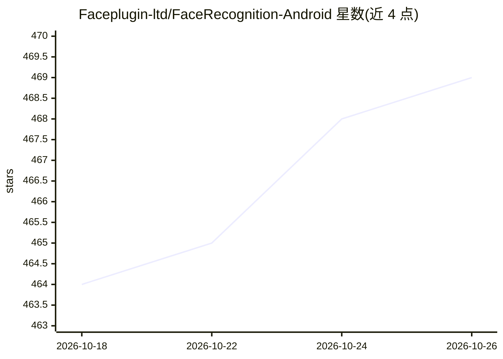

# Faceplugin-ltd/FaceRecognition-Android

⭐ 469 · Kotlin · 推送 2026-10-02 · [GitHub](https://github.com/Faceplugin-ltd/FaceRecognition-Android) · [官网](https://faceplugin.com/face-recognition-sdk/) · 组织维护

**Android 端人脸识别 SDK 演示应用：离线完成注册/1:N 识别与活体检测**

FacePlugin 公司的 Android 人脸识别 SDK 示例仓库：运行时为需从 Google Drive 下载的 facerecognitionsdk.aar，全部处理在设备本地完成，不上传生物特征数据。功能含照片注册、摄像头 1:N 识别、2D 活体/防伪、椭圆引导抓拍，以及 14 点关键点、姿态、质量、年龄、性别、情绪等属性读取。附带可复制的 Kotlin Demo kit 封装线程与 CameraX 逻辑。许可证离线绑定 applicationId，自有应用需联系厂商获取。

## 筛选速览

| 维度 | 判定 | 备注 |
|---|---|---|
| AI 角色 | `ai-native` | 本体是模型或模型工具 |
| 许可风险 | `none` | — |
| 部署形态 | `None` |  |
| 模型依赖 | — | README 未给出锁定关系 |
| 硬件要求 | — | 无带数字的原话,不猜 |
| 安装摩擦 | `low` | 无编译、无系统依赖或容器化 |
| 成熟度 | — | 结构信号不足 |

## 能力要点

- 设备本地运行，生物特征数据不发送云端
- 1:N 摄像头识别搭配 2D 活体/防伪检测
- 14 点关键点、模板提取与属性（年龄/性别/情绪/质量/姿态）读取
- 提供 FaceRecognitionClient 等 Kotlin Demo kit 复制即用

## 适用场景

- 在移动端 App 中集成离线人脸注册与 1:N 识别
- KYC 与移动开户流程中做人脸抓拍与活体检测
- 对相册照片批量输出人脸属性分析

## 场景标签

`人脸识别` · 领域:感知与多模态

## 证据(README 行号)

> L28: FacePlugin **Face Recognition SDK for Android** is a fully on-device biometric engine for KYC and mobile onboarding
> L30: All processing stays on the device. **No** biometric data is sent to FacePlugin cloud — built for banking, access c

## 星数曲线

2026-10-18 464 → 2026-10-26 469（+5）

---
*卡片 v1 · prompt 1.4 · 生成 2026-10-21 · 置信度 high · 依据 README sha `15702d2a4e22` · [字段定义](../../DATASET.md)*
