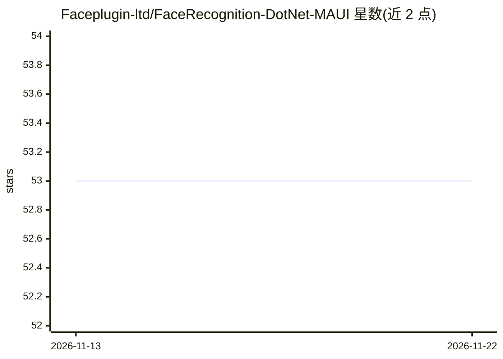

# Faceplugin-ltd/FaceRecognition-DotNet-MAUI

⭐ 53 · C# · 推送 2026-11-13 · [GitHub](https://github.com/Faceplugin-ltd/FaceRecognition-DotNet-MAUI) · [官网](https://faceplugin.com/) · 组织维护

**.NET MAUI 人脸识别 SDK 示例应用：端上注册、1:N 识别与活体检测**

FacePlugin 面向 .NET MAUI（原 Xamarin）的端上人脸识别示例应用，覆盖 Android 与 iOS。功能包括人脸注册、VideoWorker 实时 1:N 识别、椭圆引导框采集、2D 被动活体检测，以及属性估计（年龄、性别、情绪、14 个特征点、质量指标）。所有处理在设备本地完成，不上传生物特征数据。原生二进制（AAR / iOS frameworks，含 onnxruntime）需另行从 Google Drive 下载并放入项目。SDK 许可为离线授权、绑定 applicationId；使用自己的应用 id 需申请许可。

## 筛选速览

| 维度 | 判定 | 备注 |
|---|---|---|
| AI 角色 | `ai-native` | 本体是模型或模型工具 |
| 许可风险 | `none` | — |
| 部署形态 | `None` |  |
| 模型依赖 | — | README 未给出锁定关系 |
| 硬件要求 | — | 无带数字的原话,不猜 |
| 安装摩擦 | `medium` | 含编译或系统依赖之一 |
| 成熟度 | — | 结构信号不足 |

## 能力要点

- 端上人脸注册与 VideoWorker 实时 1:N 识别
- 2D 被动活体检测（默认阈值 0.8）与椭圆引导采集
- 属性估计：年龄、性别、情绪、14 个特征点、模糊/噪声/姿态质量
- 全部处理在设备本地，不向云端发送生物特征数据

## 适用场景

- 在 MAUI 应用中集成端上人脸识别与活体检测
- 搭建人脸考勤或身份核验的移动端原型
- 评估 FacePlugin SDK 的识别与属性估计能力

## 场景标签

`人脸识别` · 领域:感知与多模态

## 证据(README 行号)

> L28: FacePlugin **Face Recognition SDK for .NET MAUI** is an on-device sample for Android and iOS. Enroll faces, identif
> L30: All processing stays on the device. **No** biometric data is sent to FacePlugin cloud.

## 星数曲线

2026-11-13 53 → 2026-11-22 53（+0）

---
*卡片 v1 · prompt 1.4 · 生成 2026-11-18 · 置信度 high · 依据 README sha `542840357078` · [字段定义](../../DATASET.md)*
