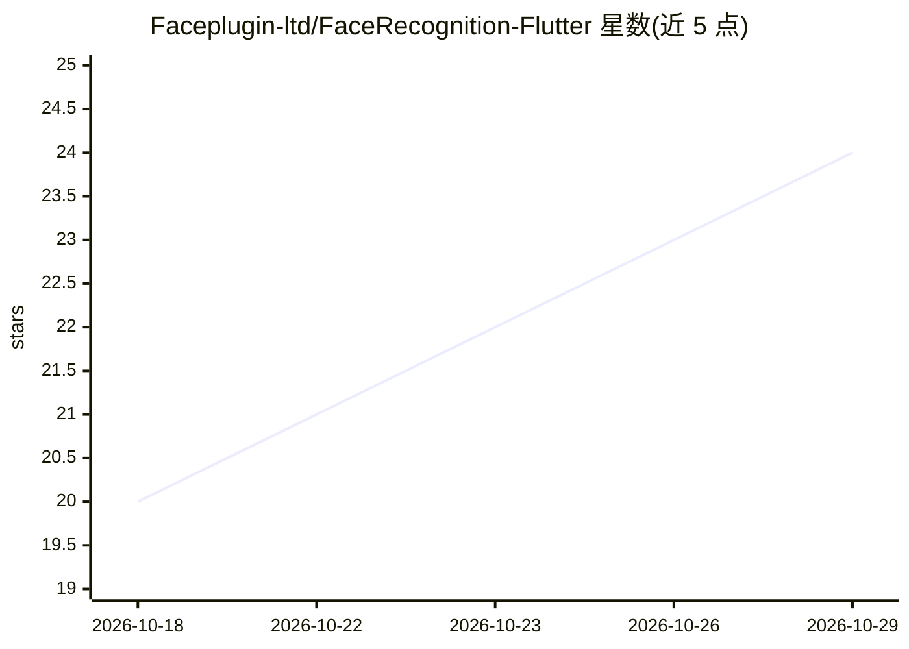

# Faceplugin-ltd/FaceRecognition-Flutter

⭐ 24 · Dart · MIT · 推送 2026-09-28 · [GitHub](https://github.com/Faceplugin-ltd/FaceRecognition-Flutter) · [官网](https://faceplugin.com/face-recognition-sdk/) · 组织维护

**面向 Flutter 的端上人脸识别 SDK 插件（注册/1:N识别/活体检测）**

FacePlugin 的 Flutter 插件 face_recognition_sdk，封装与 Android/iOS 原生应用相同的引擎，提供人脸注册、VideoWorker 实时 1:N 识别、椭圆引导采集、2D 活体/反欺诈、属性（年龄/性别/情绪/口罩/眼镜）、14 点关键点与质量评估。全部处理在设备端完成，不向云端发送生物特征数据，面向 KYC/eKYC 与移动端入驻场景。原生二进制（AAR/iOS 框架）需从 Google Drive 下载并手动放置；许可为离线机器码绑定 applicationId/bundle id，示例应用自带演示许可，自用 id 需联系获取。含完整示例应用与 Dart API。

## 筛选速览

| 维度 | 判定 | 备注 |
|---|---|---|
| AI 角色 | `ai-native` | 本体是模型或模型工具 |
| 许可风险 | `permissive` | MIT |
| 部署形态 | `None` |  |
| 模型依赖 | — | README 未给出锁定关系 |
| 硬件要求 | — | 无带数字的原话,不猜 |
| 安装摩擦 | `low` | 无编译、无系统依赖或容器化 |
| 成熟度 | — | 结构信号不足 |

## 能力要点

- 全离线设备端处理，生物数据不上传云端
- 实时 1:N 识别（VideoWorker）与 2D 活体/反欺诈
- 属性输出：年龄/性别/情绪/口罩/眼镜/14 点关键点/质量分数
- Dart API 覆盖激活、检测、模板提取、1:1 比对与实时流事件

## 适用场景

- 在 Flutter 应用中集成 KYC/eKYC 人脸验证流程
- 做带活体检测的实时 1:N 人脸门禁或识别 demo
- 采集带椭圆引导和质量评估的人脸照片用于注册

## 场景标签

`人脸识别` · 领域:感知与多模态

## 证据(README 行号)

> L33: FacePlugin **Face Recognition SDK for Flutter** is a fully on-device biometric plugin for Android and iOS. Enroll f
> L52: |2D liveness / anti-spoofing on identify|✓|

## 星数曲线

2026-10-18 20 → 2026-10-29 24（+4）

---
*卡片 v1 · prompt 1.4 · 生成 2026-10-27 · 置信度 high · 依据 README sha `89cba3d1fc0c` · [字段定义](../../DATASET.md)*
