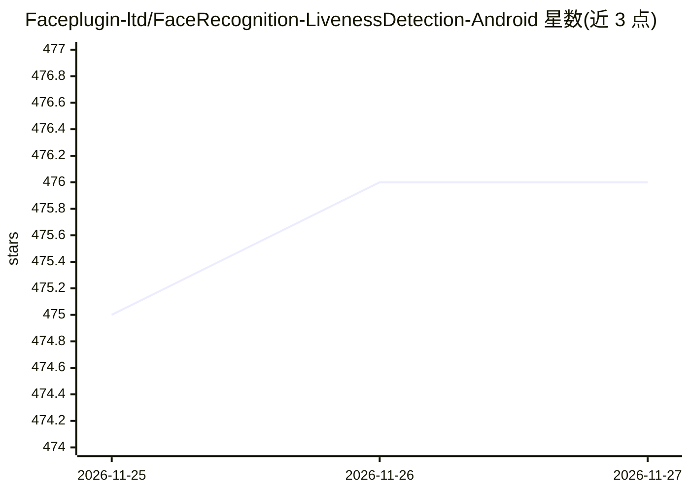

# Faceplugin-ltd/FaceRecognition-LivenessDetection-Android

⭐ 476 · Kotlin · 推送 2026-11-26 · [GitHub](https://github.com/Faceplugin-ltd/FaceRecognition-LivenessDetection-Android) · [官网](https://faceplugin.com/face-recognition-sdk/) · 组织维护

**为 Android 开发者提供端侧人脸识别与活体检测 SDK 及演示应用**

FacePlugin 的 Android SDK 仓库，包含引擎二进制（facerecognitionsdk.aar）、两个辅助库模块和演示应用，全部在设备端运行，数据不上传服务器。核心能力为 1:N 身份识别（本机底库检索并返回排序候选）、被动活体检测、人脸检测与属性（姿态/表情/年龄/性别/关键点）、模板提取与相似度比对、录入查重及引导式拍摄。引擎约 80 MB，需从 Releases 下载；许可密钥与 applicationId 绑定，演示应用自带示例密钥，自建应用需联系获取。

## 筛选速览

| 维度 | 判定 | 备注 |
|---|---|---|
| AI 角色 | `ai-native` | 本体是模型或模型工具 |
| 许可风险 | `none` | — |
| 部署形态 | `desktop` | 安装包/桌面程序 |
| 模型依赖 | — | README 未给出锁定关系 |
| 硬件要求 | — | 无带数字的原话,不猜 |
| 安装摩擦 | `medium` | 含编译或系统依赖之一 |
| 成熟度 | — | 结构信号不足 |

## 能力要点

- 端侧 1:N 识别：底库存于本机 SQLite，人脸数据不出设备
- 被动活体检测（anti-spoofing）与图像质量评估
- 检测/关键点/姿态/属性/年龄/性别一次性输出
- CallReport 记录每次引擎调用的步骤、结果与耗时

## 适用场景

- 银行、门禁等需要在设备本地完成人脸身份核验的场景
- eKYC 流程中的活体检测与证照人脸比对
- 离线环境下的人员录入与 1:N 查询

## 场景标签

`人脸识别` · 领域:感知与多模态

## 证据(README 行号)

> L21: FacePlugin **Face Recognition + Liveness Detection for Android** runs face recognition and passive liveness entirel
> L29: |**1:N identification** against the on-device gallery|`FaceGallery.identify`|
> L31: |Passive liveness (anti-spoofing)|`face.liveness` · `FaceLimits.isLive`|

## 星数曲线

2026-11-25 475 → 2026-11-27 476（+1）

---
*卡片 v1 · prompt 1.4 · 生成 2026-11-26 · 置信度 high · 依据 README sha `64b44b8810ea` · [字段定义](../../DATASET.md)*
