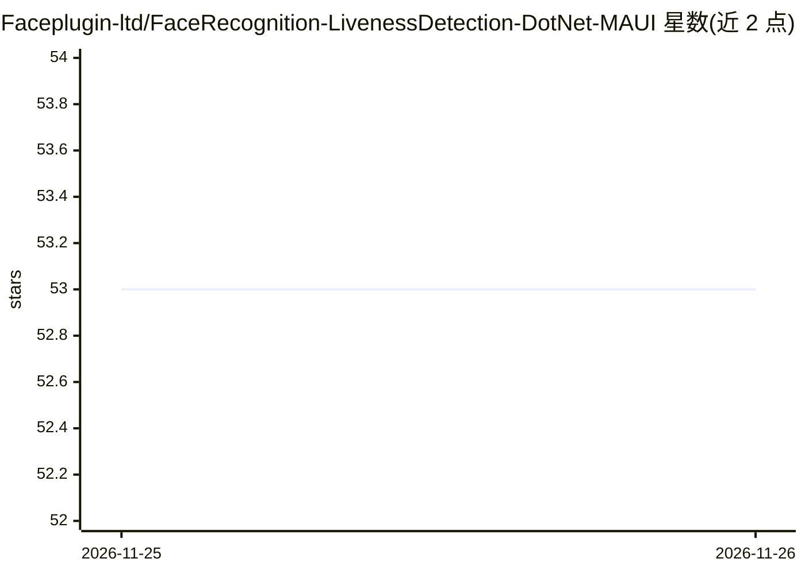

# Faceplugin-ltd/FaceRecognition-LivenessDetection-DotNet-MAUI

⭐ 53 · C# · 推送 2026-11-24 · [GitHub](https://github.com/Faceplugin-ltd/FaceRecognition-LivenessDetection-DotNet-MAUI) · [官网](https://faceplugin.com/) · 组织维护

**面向 .NET MAUI 开发者的端侧人脸识别与活体检测 SDK 演示应用**

FacePlugin 提供的 .NET MAUI 项目：包含 MAUI 应用工程、Android/iOS 原生绑定（FaceSdk）与演示 UI，在设备端离线运行人脸检测、被动活体（反欺诈）、模板提取、1:1 相似度与实时 1:N 识别，数据不发送到服务器。引擎二进制需从 GitHub Release 页另行下载（AAR/四个 iOS framework）；许可为离线 license，绑定应用 id，向维护方索取。无 NuGet 包，通过克隆仓库集成。

## 筛选速览

| 维度 | 判定 | 备注 |
|---|---|---|
| AI 角色 | `ai-native` | 本体是模型或模型工具 |
| 许可风险 | `none` | — |
| 部署形态 | `desktop` | 安装包/桌面程序 |
| 模型依赖 | — | README 未给出锁定关系 |
| 硬件要求 | — | 无带数字的原话,不猜 |
| 安装摩擦 | `medium` | 含编译或系统依赖之一 |
| 成熟度 | — | 结构信号不足 |

## 能力要点

- 设备端离线运行：人脸检测、被动活体、模板提取、1:1/1:N 识别
- 同一引擎二进制在 Android 与 iOS 输出一致分数
- 演示应用含五个标签页：身份识别、人员登记、属性分析、活体检测、阈值设置
- 通过 FaceSdk C# API 暴露 DetectAsync/SimilarityAsync/StartVideoWorkerAsync 等接口

## 适用场景

- 为银行或门禁类应用集成端侧人脸识别与活体检测
- 在 .NET MAUI 应用中实现登记、1:N 识别与反欺诈校验
- 需要隐私优先、数据不出设备的身份验证场景

## 场景标签

`人脸识别` · 领域:感知与多模态

## 证据(README 行号)

> L22: FacePlugin **Face Recognition + Liveness Detection for .NET MAUI** runs face recognition and passive liveness entir
> L32: |Face detection (bounding box, landmarks, pose, attributes)|`FaceSdk.DetectAsync`|
> L36: |**1:N identification** on a live camera feed|`StartVideoWorkerAsync` · `SyncDatabaseAsync` · `AddFrameAsync` · `Po

## 星数曲线

2026-11-25 53 → 2026-11-26 53（+0）

---
*卡片 v1 · prompt 1.4 · 生成 2026-11-24 · 置信度 high · 依据 README sha `2021aad6d406` · [字段定义](../../DATASET.md)*
