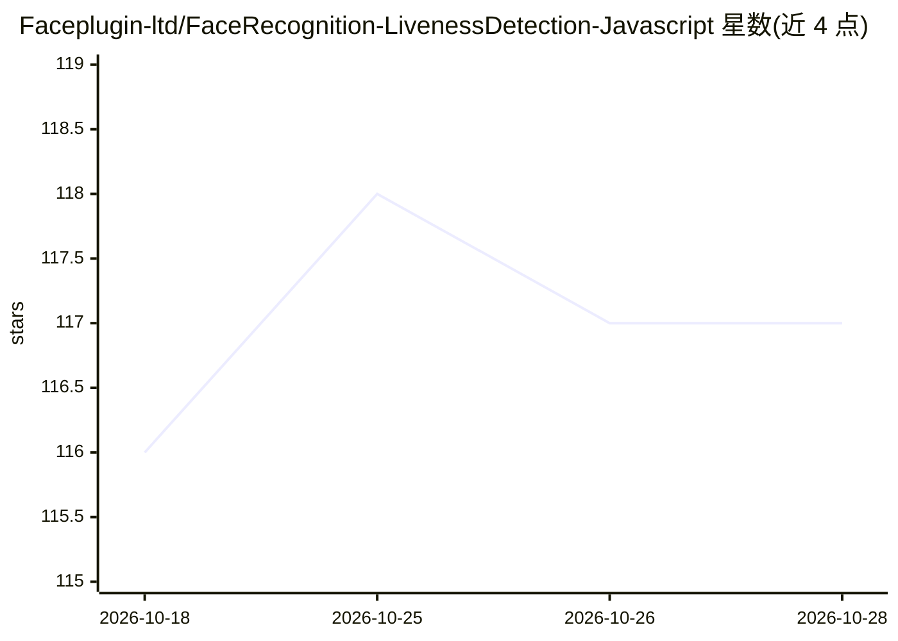

# Faceplugin-ltd/FaceRecognition-LivenessDetection-Javascript

⭐ 117 · JavaScript · MIT · 推送 2026-09-21 · [GitHub](https://github.com/Faceplugin-ltd/FaceRecognition-LivenessDetection-Javascript) · [官网](https://faceplugin.com/) · 组织维护

**浏览器端人脸识别与活体检测 JavaScript SDK**

基于 ONNX Runtime Web 与 OpenCV.js 的本地人脸分析 SDK，npm 包安装后在浏览器内运行，数据不离开设备。提供加载模型与预测的 API：人脸检测、关键点提取、活体检测（防打印照片/视频回放/3D 面具等欺骗）、表情识别、姿态估计、眼睛闭合、性别与年龄检测，以及输出 512 维特征向量的人脸识别。README 自称 NIST FRVT 排名靠前、iBeta level 2 活体引擎；同一供应商还提供 Android/iOS/Flutter 等多平台版本，涉及商业 SDK 产品线。限制：模型文件与许可条款未在 README 中说明。

## 筛选速览

| 维度 | 判定 | 备注 |
|---|---|---|
| AI 角色 | `ai-native` | 本体是模型或模型工具 |
| 许可风险 | `permissive` | MIT |
| 部署形态 | `library` | 以包/库形式分发 |
| 模型依赖 | — | README 未给出锁定关系 |
| 硬件要求 | — | 无带数字的原话,不猜 |
| 安装摩擦 | `low` | 无编译、无系统依赖或容器化 |
| 成熟度 | — | 结构信号不足 |

## 能力要点

- 完全在浏览器本地推理，数据不出设备
- 活体检测（反欺骗）防打印照片、视频回放、3D 面具
- 512 维特征向量人脸识别 API
- 覆盖检测/关键点/表情/姿态/闭眼/性别/年龄的统一 API

## 适用场景

- Web 应用中做刷脸身份验证与防伪
- 在浏览器本地分析人脸属性（年龄、性别、表情）
- 离线或隐私敏感场景下的人脸比对

## 场景标签

`人脸识别` · 领域:感知与多模态

## 证据(README 行号)

> L5: Experience the epitome of speed and fairness with our `face recognition model` **Top-ranked on NIST FRVT**, coupled 
> L6:  This is `on-premise SDK` which means everything is processed on the browser and **NO** data leaves the device
> L141: extractFeature(session, canvas_id, landmarks)

## 星数曲线

2026-10-18 116 → 2026-10-28 117（+1）

---
*卡片 v1 · prompt 1.4 · 生成 2026-10-23 · 置信度 high · 依据 README sha `77cefa5be7ca` · [字段定义](../../DATASET.md)*
