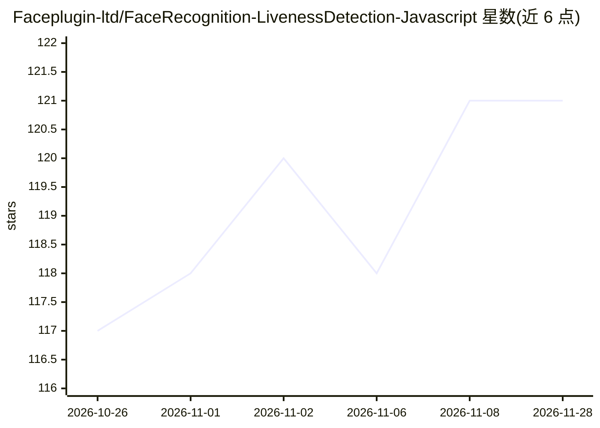

# Faceplugin-ltd/FaceRecognition-LivenessDetection-Javascript

⭐ 121 · JavaScript · MIT · 推送 2026-11-14 · [GitHub](https://github.com/Faceplugin-ltd/FaceRecognition-LivenessDetection-Javascript) · [官网](https://faceplugin.com/) · 组织维护

**浏览器端人脸识别与活体检测 JavaScript SDK**

基于 ONNX Runtime Web 与 OpenCV.js 的端侧（on-premise）人脸 SDK，全部计算在浏览器内完成，数据不离开设备。提供人脸检测、512 维特征提取与比对、被动活体检测（防照片/视频回放/3D 面具，按 ISO/IEC 30107-3 方法内部测试）、关键点、姿态、表情、闭眼、性别与年龄估计等 API。通过 npm 安装，另提供 Vue/React 示例，并有多平台版本产品线。

## 筛选速览

| 维度 | 判定 | 备注 |
|---|---|---|
| AI 角色 | `ai-native` | 本体是模型或模型工具 |
| 许可风险 | `permissive` | MIT |
| 部署形态 | `library` | 以包/库形式分发 |
| 模型依赖 | — | README 未给出锁定关系 |
| 硬件要求 | — | 无带数字的原话,不猜 |
| 安装摩擦 | `low` | 无编译、无系统依赖或容器化 |
| 成熟度 | — | 结构信号不足 |

## 能力要点

- 被动活体检测，防护打印照片、视频回放、3D 面具及 deepfake
- 512 维特征向量的人脸识别/比对，全程浏览器内运行、数据不出设备
- 覆盖检测、关键点、姿态、表情、闭眼、性别、年龄等 API
- 提供 Vue.js 与 React.js 示例工程

## 适用场景

- 在网页端做人脸验证/身份核验而不上传人脸数据
- 登录流程中加入人脸活体防伪校验
- 从人脸图像提取表情、年龄、性别等属性

## 场景标签

`人脸识别` · 领域:感知与多模态

## 证据(README 行号)

> L3: # Face Recognition SDK Javascript - Fully On Premise
> L5: Experience speed and fairness with our `face recognition model`, **evaluated in NIST FRTE (formerly FRVT)**, paired 
> L6:  This is `on-premise SDK` which means everything is processed on the browser and **NO** data leaves the device

## 星数曲线

2026-10-26 117 → 2026-11-28 121（+4）

---
*卡片 v1 · prompt 1.4 · 生成 2026-11-28 · 置信度 high · 依据 README sha `6cf8834a0752` · [字段定义](../../DATASET.md)*
