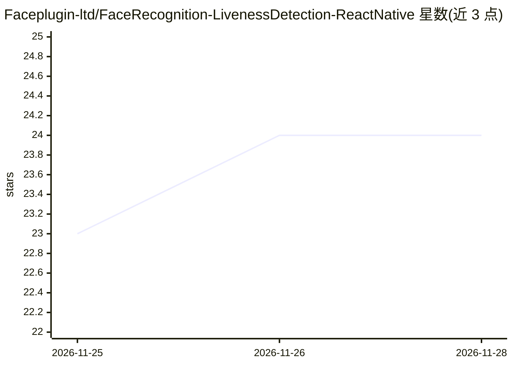

# Faceplugin-ltd/FaceRecognition-LivenessDetection-ReactNative

⭐ 24 · TypeScript · MIT · 推送 2026-11-27 · [GitHub](https://github.com/Faceplugin-ltd/FaceRecognition-LivenessDetection-ReactNative) · [官网](https://faceplugin.com/face-recognition-sdk/) · 组织维护

**React Native 人脸识别+被动活体检测插件，全离线端侧运行**

FacePlugin 提供的 React Native 插件（face-recognition-sdk），含 Android/iOS 原生桥与示例应用，人脸检测、被动活体（反欺骗）、质量评估、模板提取、1:1 相似度与摄像头实时 1:N 识别全部在设备端运行，数据不上传服务器。引擎二进制从 GitHub release 页下载放入工程，许可证离线绑定 applicationId/bundle id，示例应用自带演示密钥，自有应用需联系厂商获取。集成方式为克隆本仓库以本地 file: 依赖引入，无 npm 包。

## 筛选速览

| 维度 | 判定 | 备注 |
|---|---|---|
| AI 角色 | `ai-native` | 本体是模型或模型工具 |
| 许可风险 | `permissive` | MIT |
| 部署形态 | `desktop` | 安装包/桌面程序 |
| 模型依赖 | — | README 未给出锁定关系 |
| 硬件要求 | — | 无带数字的原话,不猜 |
| 安装摩擦 | `medium` | 含编译或系统依赖之一 |
| 成熟度 | — | 结构信号不足 |

## 能力要点

- 端侧运行人脸检测、被动活体、模板提取、1:1/1:N 识别，数据不上传
- 示例应用含五个功能页：识别、注册、属性、活体、阈值设置
- 许可证离线绑定应用 id，getMachineCode/setActivation 激活
- Android AAR 与 iOS framework 来自同一引擎，双平台分数一致

## 适用场景

- 在金融类 App 中做带活体检测的人脸核身
- 门禁/考勤类应用端侧 1:N 人脸识别
- 对照片批量提取人脸属性（年龄、性别、表情、姿态）

## 场景标签

`人脸识别` · 领域:感知与多模态

## 证据(README 行号)

> L22: FacePlugin **Face Recognition + Liveness Detection for React Native** runs face recognition and passive liveness en
> L32: |Face detection (bounding box, landmarks, pose, attributes)|`faceDetection`|
> L36: |**1:N identification** on a live camera feed|`startVideoWorker` · `syncVideoWorkerDatabase` · `addVideoWorkerFrame

## 星数曲线

2026-11-25 23 → 2026-11-28 24（+1）

---
*卡片 v1 · prompt 1.4 · 生成 2026-11-24 · 置信度 high · 依据 README sha `5ccc722b7a75` · [字段定义](../../DATASET.md)*
