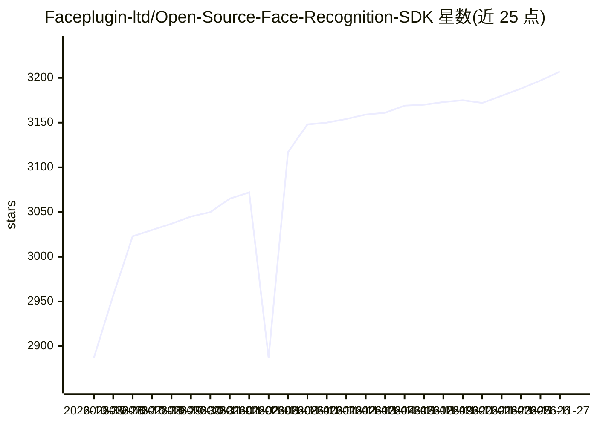

# Faceplugin-ltd/Open-Source-Face-Recognition-SDK

⭐ 3,207 · Python · 推送 2026-11-21 · [GitHub](https://github.com/Faceplugin-ltd/Open-Source-Face-Recognition-SDK) · [官网](https://faceplugin.com/) · 组织维护

**面向开发者的本地人脸识别 Python SDK，覆盖检测比对全流程**

Faceplugin 发布的 Python 人脸识别 SDK，在 Windows 与 Linux 上本地运行，提供人脸检测与边界框提取、关键点检测、特征嵌入生成与相似度比对（默认阈值 75，返回 0-100 分值），支持 JPG/PNG/BMP/TIFF 多格式与单图多人脸。全部处理在本机完成，数据不出设备；GPU 可选，CPU 环境亦可运行。安装路径为 conda 环境 + pip 依赖，通过 run.py 验证。Liveness/防伪、证件识别等能力指向该公司单独的商业 SDK 产品线。

## 筛选速览

| 维度 | 判定 | 备注 |
|---|---|---|
| AI 角色 | `ai-native` | 本体是模型或模型工具 |
| 许可风险 | `none` | — |
| 部署形态 | `library` | 以包/库形式分发 |
| 模型依赖 | — | README 未给出锁定关系 |
| 硬件要求 | `cpu-ok` | |
| 安装摩擦 | `low` | 无编译、无系统依赖或容器化 |
| 成熟度 | — | 结构信号不足 |

## 能力要点

- 人脸检测、关键点、特征嵌入与相似度比对（阈值默认 75）
- 100% 本地处理，数据不出设备
- GPU 可选，CPU-only 系统可用
- 支持 JPG/PNG/BMP/TIFF 多格式与单图多人脸

## 适用场景

- 给应用接入人脸生物识别登录
- 门禁/考勤系统的人脸比对
- 零售客流分析与访客管理

## 场景标签

`人脸识别` · 领域:感知与多模态

## 证据(README 行号)

> L14: The **Open Source Face Recognition SDK** by Faceplugin is a powerful, privacy-focused solution for integrating face
> L30: - Face detection and bounding box extraction
> L32: - Feature embedding generation

## 星数曲线

2026-10-25 2,887 → 2026-11-27 3,207（+320）

---
*卡片 v1 · prompt 1.4 · 生成 2026-11-23 · 置信度 high · 依据 README sha `e943fc1d1642` · [字段定义](../../DATASET.md)*
