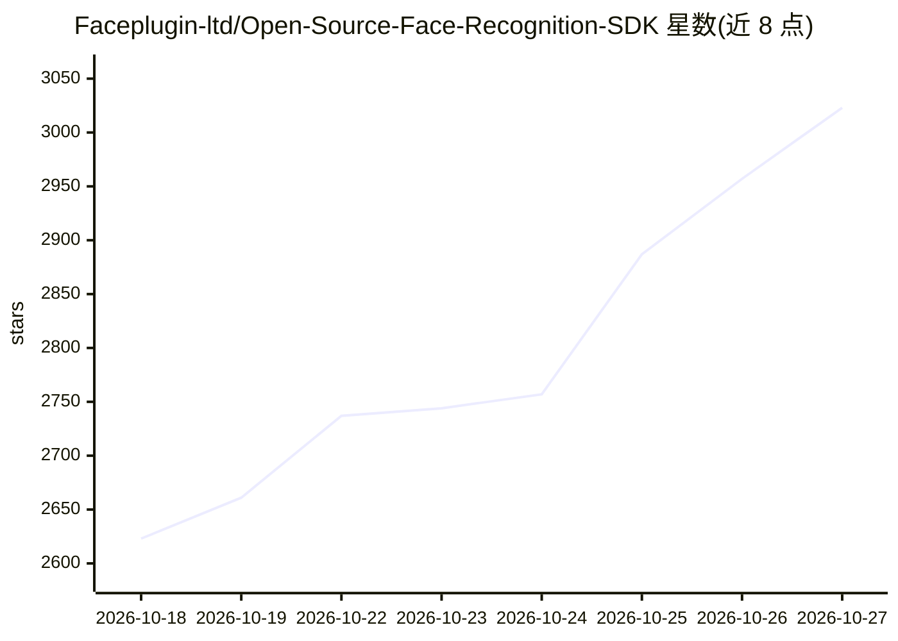

# Faceplugin-ltd/Open-Source-Face-Recognition-SDK

⭐ 3,023 · Python · 推送 2026-10-02 · [GitHub](https://github.com/Faceplugin-ltd/Open-Source-Face-Recognition-SDK) · [官网](https://faceplugin.com/) · 组织维护

**开源人脸识别 SDK：本地完成人脸检测、关键点与比对**

Faceplugin 公司发布的 Python 人脸识别 SDK，本地运行深度学习模型，提供人脸检测与边界框提取、关键点检测、特征向量生成与人脸相似度比对（0-100 分，默认阈值 75）。支持 JPG/PNG/BMP/TIFF 格式与单图多脸检测，Windows/Linux 可用，CPU 即可运行、GPU 可选。通过 conda 环境 + pip 安装 requirements.txt 部署。README 同时列出同公司的商业 SDK（活体检测、证件识别等）。

## 筛选速览

| 维度 | 判定 | 备注 |
|---|---|---|
| AI 角色 | `ai-native` | 本体是模型或模型工具 |
| 许可风险 | `none` | — |
| 部署形态 | `library` | 以包/库形式分发 |
| 模型依赖 | — | README 未给出锁定关系 |
| 硬件要求 | `cpu-ok` | |
| 安装摩擦 | `low` | 无编译、无系统依赖或容器化 |
| 成熟度 | — | 结构信号不足 |

## 能力要点

- 人脸检测、关键点、特征嵌入与相似度比对
- 全部处理本地进行，不外传数据
- CPU-only 可运行，GPU 可选
- 支持 JPG/PNG/BMP/TIFF 与单图多脸

## 适用场景

- 门禁与刷脸登录的人脸比对
- 考勤签到等企业应用
- IoT/移动应用集成人脸识别功能

## 场景标签

`人脸识别` · 领域:感知与多模态

## 证据(README 行号)

> L14: The **Open Source Face Recognition SDK** by Faceplugin is a powerful, privacy-focused solution for integrating face
> L30: - Feature embedding generation
> L31: - Face similarity comparison

## 星数曲线

2026-10-18 2,623 → 2026-10-27 3,023（+400）

---
*卡片 v1 · prompt 1.4 · 生成 2026-10-21 · 置信度 high · 依据 README sha `d27e673deeef` · [字段定义](../../DATASET.md)*
