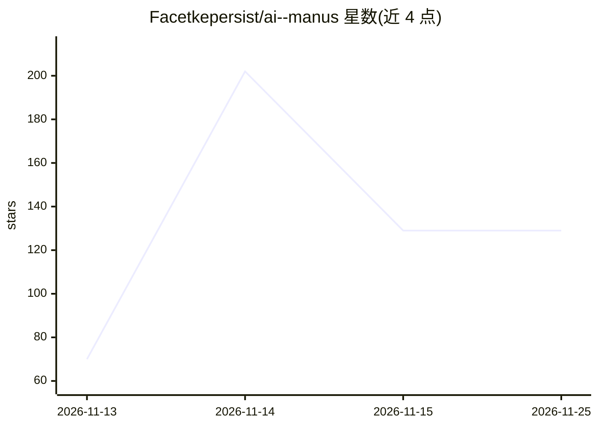

# Facetkepersist/ai--manus

⭐ 129 · Apache-2.0 · 推送 2026-11-15 · [GitHub](https://github.com/Facetkepersist/ai--manus) · 个人维护

**面向个人用户的通用自主 AI Agent：自动执行代码与浏览器操作**

README 描述的自主 AI Agent 系统，声称可在沙盒环境中运行多种工具：自主执行代码/脚本、控制浏览器（导航网页、填写表单、采集信息）、执行多步骤日常任务，面向学习、家庭与轻量办公场景。README 提供兼容性表（最低 4GB 内存、双核 CPU）与六步上手流程（准备/配置/测试/细化/应用/维护），但未给出可验证的安装命令、源码结构或模型接入方式，顶部有“Download Manus / PROMO2026”下载指引。

## 筛选速览

| 维度 | 判定 | 备注 |
|---|---|---|
| AI 角色 | `ai-native` | 本体是模型或模型工具 |
| 许可风险 | `permissive` | Apache-2.0 |
| 部署形态 | `None` |  |
| 模型依赖 | — | README 未给出锁定关系 |
| 硬件要求 | — | 无带数字的原话,不猜 |
| 安装摩擦 | `low` | 无编译、无系统依赖或容器化 |
| 成熟度 | — | 结构信号不足 |

## 能力要点

- 声称支持自主代码执行与浏览器控制
- 多步骤任务自动化，脚本与浏览器操作可衔接
- 面向家庭、学习与小规模工作的个人助手定位
- README 给出最低/推荐硬件兼容性表

## 适用场景

- 让 Agent 代为完成重复性的代码与网页操作
- 学习与研究中收集资料、整理笔记、运行小脚本
- 轻量办公中跨多页面采集信息并汇总

## 场景标签

`AI 助手` `浏览器自动化` `工作流自动化` · 领域:效率与自动化

## 证据(README 行号)

> L18: Manus is an autonomous AI agent designed to run code and control a browser on your behalf. Instead of acting like a
> L10: - **Autonomous Code Execution:** Manus AI agent runs code on its own to complete tasks, so you can focus on decisio

## 星数曲线

2026-11-13 70 → 2026-11-25 129（+59）

---
*卡片 v1 · prompt 1.4 · 生成 2026-11-17 · 置信度 mid · 依据 README sha `a3d88e202bf0` · [字段定义](../../DATASET.md)*
