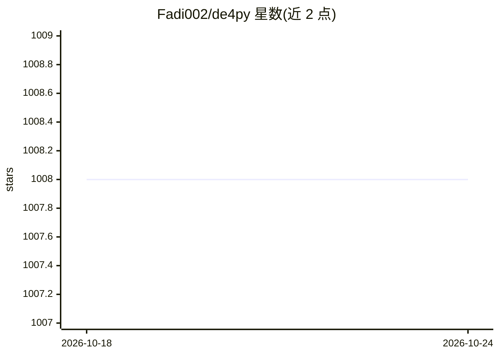

# Fadi002/de4py

⭐ 1,008 · Python · NOASSERTION · 推送 2026-08-25 · [GitHub](https://github.com/Fadi002/de4py) · 个人维护

**面向逆向工程师的 Python 反混淆工具箱（含 AI 反混淆引擎）**

基于 PySide6 的 Python 反混淆与分析工具，面向恶意软件分析师与逆向工程师。核心功能包括：Onyx 引擎利用本地 LLM（经 Ollama，默认 qwen2.5-coder:1.5b）结合 AST 清洗与控制流复原处理重度混淆代码；对 Jawbreaker、BlankOBF 等常见混淆器的直接反混淆；文件分析、进程内代码执行、行为监控、插件系统与 18+ 语言本地化。Windows 为推荐平台，Python 3.10+，源码 pip 安装，提供 GUI 与 CLI 两种模式。许可为 CC BY-NC 4.0，禁止商用。

## 筛选速览

| 维度 | 判定 | 备注 |
|---|---|---|
| AI 角色 | `ai-enhanced` | 去掉 AI 部分产品仍成立 |
| 许可风险 | `none` | NOASSERTION |
| 部署形态 | `library` | 以包/库形式分发 |
| 模型依赖 | local-ok | 支持本地模型 |
| 硬件要求 | — | 无带数字的原话,不猜 |
| 安装摩擦 | `low` | 无编译、无系统依赖或容器化 |
| 成熟度 | — | 结构信号不足 |

## 能力要点

- Onyx 引擎用本地 LLM（Ollama）结合 AST 清洗与模式匹配反混淆
- 直接支持 Jawbreaker/BlankOBF/PlusOBF/Wodx 等常见混淆器
- 检测 PyInstaller/unpy2exe 打包、哈希计算与可疑字符串查找
- 插件架构与可编程库用法，18+ 语言本地化

## 适用场景

- 分析被常见 Python 混淆器加壳的样本
- 检测文件打包器并提取元数据与可疑字符串
- 在目标进程中执行代码做动态分析

## 场景标签

`网络安全` · 领域:学习与行业

## 证据(README 行号)

> L8: De4py is an advanced Python deobfuscator with a beautiful UI (PySide6) and a robust set of features for malware anal
> L16: |**Onyx Engine (AI)**|Advanced deobfuscation utilizing local LLMs (Ollama) combined with AST cleaning, control-flow

## 星数曲线

2026-10-18 1,008 → 2026-10-24 1,008（+0）

---
*卡片 v1 · prompt 1.4 · 生成 2026-10-21 · 置信度 mid · 依据 README sha `ee532d96bc49` · [字段定义](../../DATASET.md)*
