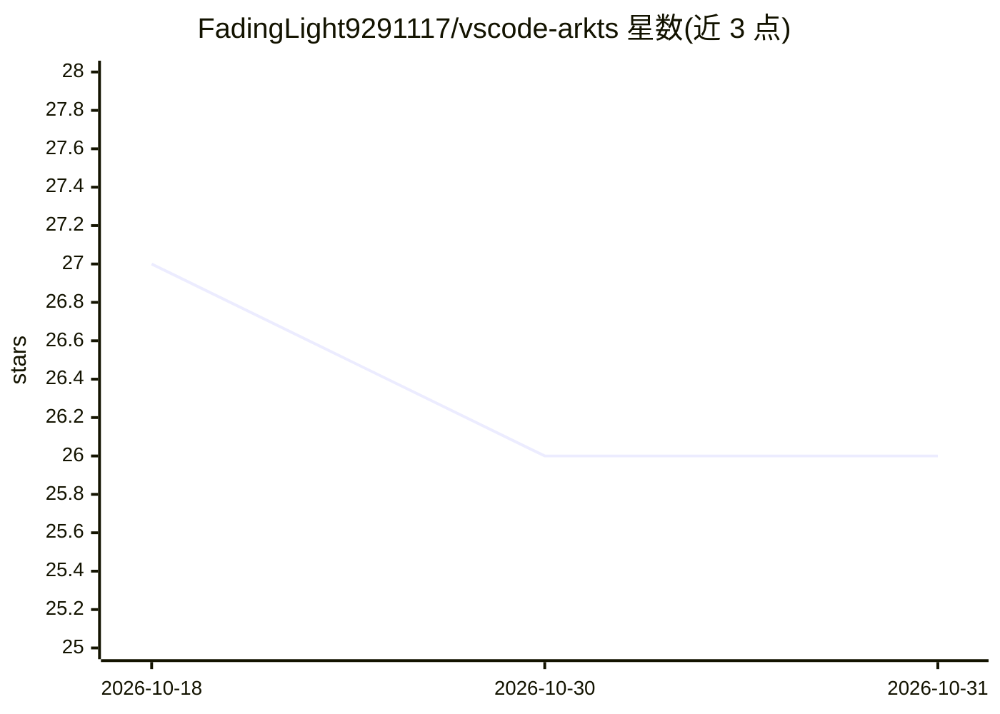

# FadingLight9291117/vscode-arkts

⭐ 26 · TypeScript · MIT · 推送 2026-08-09 · [GitHub](https://github.com/FadingLight9291117/vscode-arkts) · 个人维护 · 中文 README

**给鸿蒙开发者的 VS Code ArkTS 语言支持扩展，含 20 个 MCP 工具**

面向使用 Visual Studio Code 进行 HarmonyOS（ArkTS）开发的扩展：提供 LSP 驱动的补全、诊断、跳转、格式化、Linter 与 $r() 资源校验，编辑器标题栏一键编译/运行（调用 devecocli，自动定位 oh-package.json5 项目根），并内置 20 个 MCP 工具供 Claude、Copilot、Cursor、OpenCode 等 AI 助手操作设备、项目、构建、应用、文件与日志。前置要求 DevEco Studio 与 hdc，必须配置 ets.sdkPath 否则语言服务器不启动。语言服务器与 devecocli 在首次使用时自动安装，插件本体约 545 KB。

## 筛选速览

| 维度 | 判定 | 备注 |
|---|---|---|
| AI 角色 | `ai-enhanced` | 去掉 AI 部分产品仍成立 |
| 许可风险 | `permissive` | MIT |
| 部署形态 | `library` | 以包/库形式分发 |
| 模型依赖 | — | README 未给出锁定关系 |
| 硬件要求 | — | 无带数字的原话,不猜 |
| 安装摩擦 | `low` | 无编译、无系统依赖或容器化 |
| 成熟度 | — | 结构信号不足 |

## 能力要点

- LSP 驱动的补全/诊断/跳转/格式化与 ArkTS Linter 检查
- 标题栏一键编译/运行（devecocli build/run，自动识别项目根）
- 内置 20 个 MCP 工具：设备管理/构建/应用管理/文件传输/日志诊断
- 语言服务器与 devecocli 按需自动安装，插件约 545 KB

## 适用场景

- 在 VS Code 中开发鸿蒙 ArkTS 应用并获得补全与诊断
- 通过 AI 助手直接操作 HarmonyOS 设备（安装、启动、抓日志、截图）
- 在 Claude Desktop 等外部工具中使用 HarmonyOS MCP 工具

## 场景标签

 · 领域:开发工具/HarmonyOS

## 证据(README 行号)

> L7: 为 Visual Studio Code 提供 ArkTS（鸿蒙应用开发语言）完整语言支持：标题栏一键编译/运行、LSP 驱动的补全与诊断，并内置 20 个 MCP 工具，让 Claude、Copilot、Cursor、OpenCo
> L53: ### MCP 工具（AI 集成，20 个）

## 星数曲线

2026-10-18 27 → 2026-10-31 26（-1）

---
*卡片 v1 · prompt 1.4 · 生成 2026-10-26 · 置信度 mid · 依据 README sha `c34241d912a5` · [字段定义](../../DATASET.md)*
