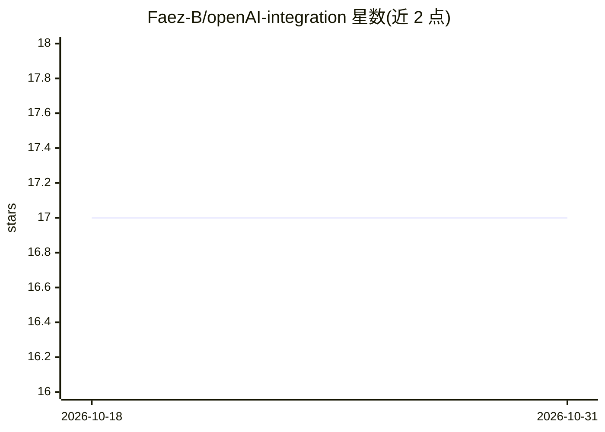

# Faez-B/openAI-integration

⭐ 17 · Vue · 推送 2026-09-14 · [GitHub](https://github.com/Faez-B/openAI-integration) · [官网](https://open-ai-integration.vercel.app) · 个人维护

**Nuxt 3 集成 OpenAI API 的演示 Web 应用**

基于 Nuxt 3 与 Bootstrap 5 的演示应用，通过环境变量配置 OpenAI API Key，在 nuxt.config.ts 的 runtimeConfig 中服务端读取密钥，接入 OpenAI API。提供 npm 安装依赖、开发服务器（localhost:3000）、生产构建与本地预览的标准 Nuxt 命令。README 明确声明这是演示应用，不用于生产环境。

## 筛选速览

| 维度 | 判定 | 备注 |
|---|---|---|
| AI 角色 | `ai-ecosystem` | LLM/agent 周边工具 |
| 许可风险 | `none` | — |
| 部署形态 | `library` | 以包/库形式分发 |
| 模型依赖 | — | README 未给出锁定关系 |
| 硬件要求 | — | 无带数字的原话,不猜 |
| 安装摩擦 | `low` | 无编译、无系统依赖或容器化 |
| 成熟度 | — | 结构信号不足 |

## 能力要点

- Nuxt 3 + Bootstrap 5 + OpenAI API 的集成示例
- 通过 .env 与 runtimeConfig 服务端读取 API Key
- 提供 npm install / dev / build / preview 标准流程

## 适用场景

- 参考如何在 Nuxt 3 中安全配置 OpenAI API Key
- 学习 Nuxt 3 Web 应用的开发与构建流程
- 作为接入 OpenAI API 的前端项目起点

## 场景标签

 · 领域:Web 开发/AI 集成示例

## 证据(README 行号)

> L1: # Nuxt 3 + Bootstrap 5 + OpenAI API
> L15: In your ```.env``` file, add your OpenAI API key:

## 星数曲线



2026-10-18 17 → 2026-10-31 17（+0）


---
*卡片 v1 · prompt 1.4 · 生成 2026-10-30 · 置信度 high · 依据 README sha `082bb6f02712` · [字段定义](../../DATASET.md)*
