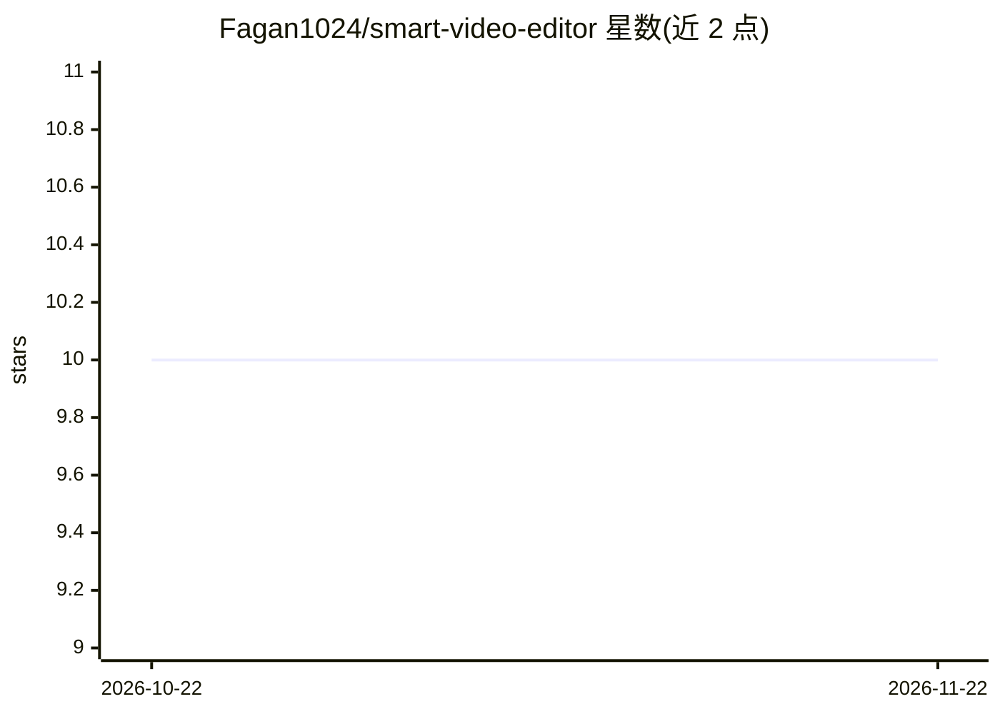

# Fagan1024/smart-video-editor

⭐ 10 · Python · MIT · 推送 2026-07-26 · [GitHub](https://github.com/Fagan1024/smart-video-editor) · [官网](https://github.com/Fagan1024/smart-video-editor#readme) · 个人维护 · 中文 README

**给 Agent 用户的视频自动剪辑 Skill：先逐帧看懂素材再剪**

以 Agent Skill 形式分发的自动剪辑工具：按固定间隔抽帧交视觉模型打可用性分，据此砍废镜头、按叙事逻辑重排、定节奏、从 9 种预设中选调色、从免费商用源抓取 BGM、生成带内置字体的片头标题，最后用 ffmpeg 渲染。剪辑决策以 JSON EDL 表达，可手改后重渲染而无需重新分析素材。安装为 git clone 复制到技能目录或 npx 安装，依赖 ffmpeg/ffprobe；不支持长视频（>5 分钟）与文生视频、ASR。

## 筛选速览

| 维度 | 判定 | 备注 |
|---|---|---|
| AI 角色 | `ai-native` | 本体是模型或模型工具 |
| 许可风险 | `permissive` | MIT |
| 部署形态 | `library` | 以包/库形式分发 |
| 模型依赖 | — | README 未给出锁定关系 |
| 硬件要求 | — | 无带数字的原话,不猜 |
| 安装摩擦 | `medium` | 含编译或系统依赖之一 |
| 成熟度 | — | 结构信号不足 |

## 能力要点

- 逐帧视觉分析并打 1-5 可用性分，帧时间戳可无歧义映射回时间轴
- 按空间/时间/情绪叙事重排片段，同段素材可拆分复用或整段丢弃
- 自动从 Pixabay、Free Music Archive 等 CC0 源获取并验证 BGM，不抓商业版权音乐
- 剪辑决策输出为 JSON EDL，修改后可直接重渲染

## 适用场景

- 把手机里零散旅行片段剪成竖屏短视频发小红书/抖音
- 多段素材质量不齐时自动淘汰糊片、抖动与空镜
- 横屏素材自动转竖屏，选裁切或模糊铺底
- 屏幕录制剪成节奏紧凑的产品演示

## 场景标签

`图像视频处理` · 领域:感知与多模态

## 证据(README 行号)

> L3: **会看画面的 AI 剪辑 Skill**
> L29: 每段素材按固定间隔抽帧，**每一帧都交给视觉模型判断**：
> L244: Agent 会自己走完：探测素材 → 抽帧 → 视觉分析 → 剪辑决策 → 找 BGM → 生成标题 → 渲染 → 交付时说明每段为什么这么剪。

## 星数曲线

2026-10-22 10 → 2026-11-22 10（+0）

---
*卡片 v1 · prompt 1.4 · 生成 2026-11-20 · 置信度 high · 依据 README sha `426c12733356` · [字段定义](../../DATASET.md)*
