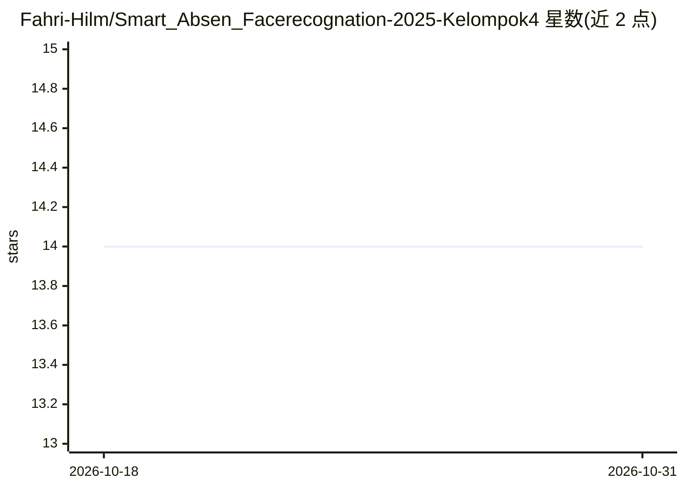

# Fahri-Hilm/Smart_Absen_Facerecognation-2025-Kelompok4

⭐ 14 · Python · 推送 2026-01-03 · [GitHub](https://github.com/Fahri-Hilm/Smart_Absen_Facerecognation-2025-Kelompok4) · 组织维护 · 中文 README

**基于人脸识别的自动考勤 Web 应用（InsightFace）**

Flask Web 应用，通过摄像头人脸识别完成员工自动签到，识别引擎为 InsightFace/ArcFace，数据存于 MySQL。功能包括 QR 码跨设备同步签到、防止单脸多次检测的 Camera Lock、实时考勤看板、CSV 导出，以及 Swagger 文档的 REST API。提供在线 Demo、Docker 一键部署与手动安装两种途径，采用环境变量与输入校验等安全实践。由 2025 软件课程小组（Kelompok 4）开发，面向印尼考勤场景。

## 筛选速览

| 维度 | 判定 | 备注 |
|---|---|---|
| AI 角色 | `ai-native` | 本体是模型或模型工具 |
| 许可风险 | `none` | — |
| 部署形态 | `self-host` | docker 或自建部署 |
| 模型依赖 | — | README 未给出锁定关系 |
| 硬件要求 | — | 无带数字的原话,不猜 |
| 安装摩擦 | `low` | 无编译、无系统依赖或容器化 |
| 成熟度 | — | 结构信号不足 |

## 能力要点

- InsightFace/ArcFace 人脸识别自动考勤
- QR 码跨设备同步签到
- 实时考勤看板与 CSV 导出
- Docker 部署与 Swagger REST API 文档

## 适用场景

- 企业/学校用摄像头人脸识别自动记录员工出勤
- 移动端与桌面端通过 QR 码同步签到
- 管理员在实时看板查看考勤并导出报表

## 场景标签

`人脸识别` · 领域:感知与多模态

## 证据(README 行号)

> L3: Sistem absensi pintar berbasis pengenalan wajah dengan akurasi 99%+ menggunakan InsightFace/ArcFace.
> L28: - **Face Recognition**: InsightFace/ArcFace (akurasi 99%+)
> L135: |POST|`/api/attendance`|Proses absensi wajah|

## 星数曲线

2026-10-18 14 → 2026-10-31 14（+0）

---
*卡片 v1 · prompt 1.4 · 生成 2026-10-31 · 置信度 mid · 依据 README sha `0ba1bb5b8536` · [字段定义](../../DATASET.md)*
