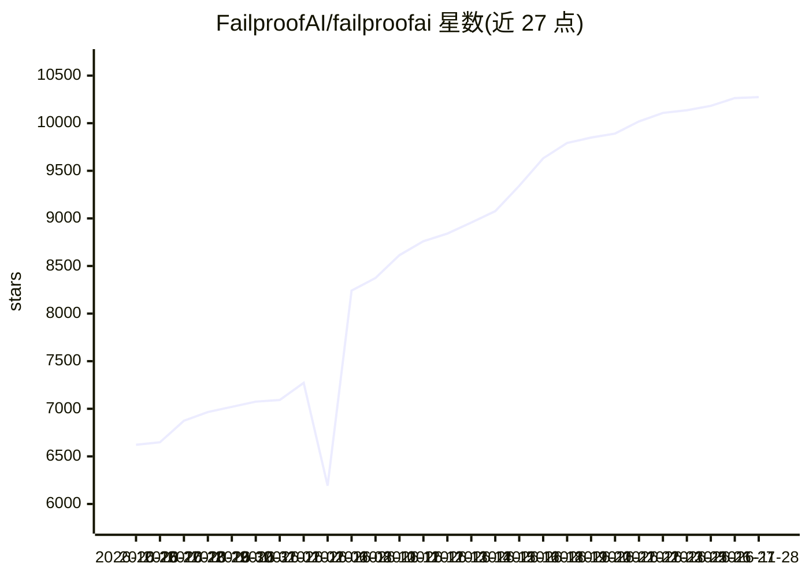

# FailproofAI/failproofai

⭐ 10,274 · TypeScript · NOASSERTION · 推送 2026-11-27 · [GitHub](https://github.com/FailproofAI/failproofai) · [官网](https://befailproof.ai) · 组织维护 · 中文 README

**为 AI agent 运行时提供追踪审计与策略强制执行的观测工具**

以 CLI + Rust 常驻守护进程的形式接入 agent 运行时，通过 hook 捕获会话启动、提示、工具调用、子 agent、压缩与停止等事件；可将事件规范化为 29 种标准事件后执行策略（allow/deny/instruct），在工具执行前拦截或中途纠正 agent。配套云服务对历史 run 做审计聚类、生成失败模式洞察并自动起草策略，支持 Python/TypeScript SDK 上报自建 agent。免安装依赖，npm 分发，商业转售受 Commons Clause 限制。

## 筛选速览

| 维度 | 判定 | 备注 |
|---|---|---|
| AI 角色 | `ai-ecosystem` | LLM/agent 周边工具 |
| 许可风险 | `none` | NOASSERTION |
| 部署形态 | `library` | 以包/库形式分发 |
| 模型依赖 | — | README 未给出锁定关系 |
| 硬件要求 | — | 无带数字的原话,不猜 |
| 安装摩擦 | `low` | 无编译、无系统依赖或容器化 |
| 成熟度 | — | 结构信号不足 |

## 能力要点

- 统一 12 个 agent harness（Claude Code、Codex、Cursor、Hermes、OpenClaw 等）为同一策略 API
- Rust 守护进程实现每次策略检查约 0.7ms p50，以系统服务方式常驻
- 策略支持 JavaScript 代码与自然语言分类模型两种形式，返回 allow/deny/instruct
- 云服务从 run 追踪自动聚类失败模式并起草对应策略

## 适用场景

- 阻止 agent 读取 .env 等敏感文件或执行危险命令
- 审计 agent 历史运行并归纳反复出现的失败模式
- 为夜间无人值守的 agent 会话提供持续策略监管
- 通过 SDK 为自建 agent 接入追踪与评测

## 场景标签

`LLM 可观测性` · 领域:评测与运维

## 证据(README 行号)

> L20: **Failproof lives in your agent's runtime and hears every hook event it fires**: the
> L150: - Every event maps onto one canonical set of 29 (`SessionStart`, `UserPromptSubmit`,
> L238: 1. **Trace.** Every prompt, model call, tool call and result, live and replayable, with

## 星数曲线

2026-10-26 6,622 → 2026-11-28 10,274（+3,652）

---
*卡片 v1 · prompt 1.4 · 生成 2026-11-22 · 置信度 high · 依据 README sha `60e59245fced` · [字段定义](../../DATASET.md)*
