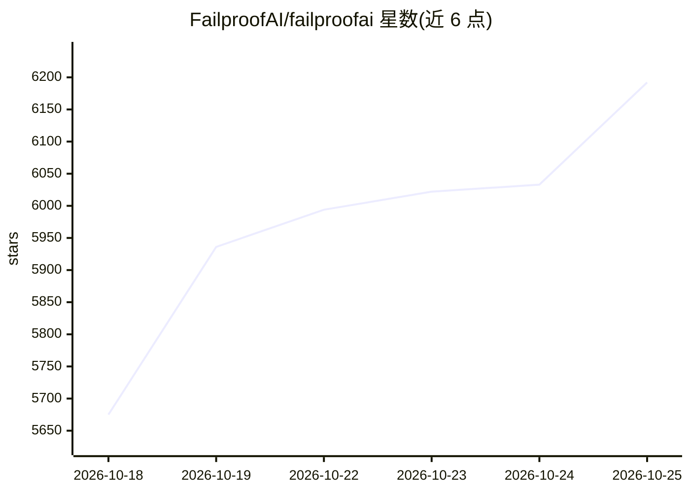

# FailproofAI/failproofai

⭐ 6,192 · TypeScript · NOASSERTION · 推送 2026-10-24 · [GitHub](https://github.com/FailproofAI/failproofai) · [官网](https://befailproof.ai) · 组织维护 · 中文 README

**AI agent 运行时观测与策略拦截工具：记录每次运行并拦截危险工具调用**

面向在多种 agent harness 中运行 AI agent 的开发者与团队：通过 hook 接入 12 种 harness（Claude Code、Codex、Cursor Agent、Hermes、OpenClaw 等），在工具调用执行前按策略拦截（40 个内置策略，如读取 .env、sudo、rm -rf、force push），并提供本地 dashboard（localhost:8020）展示运行历史、模型/工具调用序列与 hook 决策，另带离线审计与 Python SDK 上报通道。自定义策略以文件或代码形式加载。限制：许可证含 Commons Clause，商业转售需另行协议。

## 筛选速览

| 维度 | 判定 | 备注 |
|---|---|---|
| AI 角色 | `ai-ecosystem` | LLM/agent 周边工具 |
| 许可风险 | `none` | NOASSERTION |
| 部署形态 | `library` | 以包/库形式分发 |
| 模型依赖 | — | README 未给出锁定关系 |
| 硬件要求 | — | 无带数字的原话,不猜 |
| 安装摩擦 | `low` | 无编译、无系统依赖或容器化 |
| 成熟度 | — | 结构信号不足 |

## 能力要点

- hook 12 种 agent harness，工具调用前拦截（12 种全验证，turn-end 门控 8 种）
- 40 个内置策略 + 文件/代码自定义策略（allow/deny/instruct 三种决策）
- 本地 dashboard 展示运行历史与 hook 决策，无需账号
- 离线审计扫描历史中的风险模式并建议策略

## 适用场景

- 拦截 coding agent 读取密钥文件、sudo 提权、rm -rf 等危险操作
- 跨多个 agent CLI 统一查看运行历史与工具调用轨迹
- 为团队提交共享策略包并统一执行

## 场景标签

`LLM 可观测性` · 领域:评测与运维

## 证据(README 行号)

> L17: Wherever your agents run, we see it — and we can say no. Failproof hooks 12 agent
> L18: harnesses — coding CLIs like Claude Code and Codex, chat gateways like Hermes,
> L19: self-hosted assistants like OpenClaw — capturing every run and blocking dangerous

## 星数曲线

2026-10-18 5,675 → 2026-10-25 6,192（+517）

---
*卡片 v1 · prompt 1.4 · 生成 2026-10-20 · 置信度 high · 依据 README sha `b8488e0fbc5c` · [字段定义](../../DATASET.md)*
