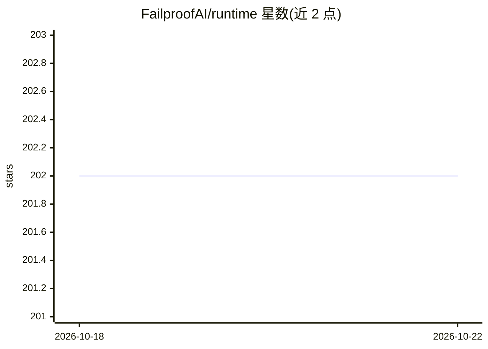

# FailproofAI/runtime

⭐ 202 · Python · NOASSERTION · 推送 2026-08-20 · [GitHub](https://github.com/FailproofAI/runtime) · [官网](https://docs.exosphere.host/) · 组织维护

**面向 AI agent 的分布式可靠性运行时与工作流编排框架**

Exosphere 是一个轻量级运行时，用于构建、编排和管理 AI agent 与工作流：基于节点的执行图模型，节点可以是 agent、API 调用或自定义逻辑；提供指数退避重试的内置失败处理、动态 fanout 并行扩展、跨重启的状态持久化（State Manager 与图级 KV 存储）、cron 触发调度，以及可视化 Dashboard 用于监控与调试。以 Python 包（PyPI）分发，本地开发可用 Docker Compose 运行 State Manager 与 Dashboard。给需要把 agent 从 demo 推向生产部署的开发者使用。

## 筛选速览

| 维度 | 判定 | 备注 |
|---|---|---|
| AI 角色 | `ai-ecosystem` | LLM/agent 周边工具 |
| 许可风险 | `none` | NOASSERTION |
| 部署形态 | `self-host` | docker 或自建部署 |
| 模型依赖 | — | README 未给出锁定关系 |
| 硬件要求 | — | 无带数字的原话,不猜 |
| 安装摩擦 | `low` | 无编译、无系统依赖或容器化 |
| 成熟度 | — | 结构信号不足 |

## 能力要点

- 节点式执行图编排，节点可为 agent/API 调用/自定义逻辑
- 内置指数退避重试与失败恢复策略
- 动态 fanout 实现大规模并行 agent 扩展
- 状态持久化与可视化 Dashboard 实时监控

## 适用场景

- 把已有 agent 代码改造为可容错、可扩展的分布式部署
- 编排包含 AI agent、API 调用与数据处理节点的复杂工作流
- 通过 Dashboard 监控和调试生产环境中的 agent 执行

## 场景标签

`工作流自动化` `Agent 框架` · 领域:Agent 开发

## 证据(README 行号)

> L15: **Exosphere** is a lightweight runtime to make AI agents resilient to failure and infinite scaling across distribut
> L30: Whether you're building data pipelines, AI agents, or complex workflow orchestrations, Exosphere provides the infra

## 星数曲线

2026-10-18 202 → 2026-10-22 202（+0）

---
*卡片 v1 · prompt 1.4 · 生成 2026-10-22 · 置信度 mid · 依据 README sha `ee8c9f8b87b9` · [字段定义](../../DATASET.md)*
