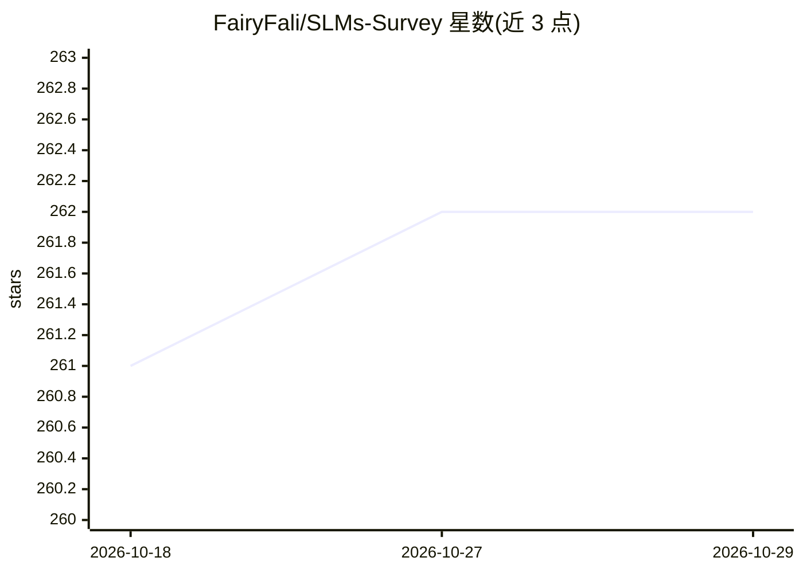

# FairyFali/SLMs-Survey

⭐ 262 · MIT · 推送 2025-11-06 · [GitHub](https://github.com/FairyFali/SLMs-Survey) · 组织维护

**小语言模型综述配套论文清单：SLM 技术与可信性研究汇编**

宾州州立大学等机构研究者维护的小语言模型（SLM）综述论文配套仓库，收录综述中讨论的论文：包括现有 SLM 模型列表（参数量、范式、领域、代码与模型链接）、SLM 架构论文、从头训练与监督微调等增强方法文献。综述已被 ACM TIST 接收，另发布 SLM-LLM 协作扩展综述与 KDD 2025 教程。面向研究人员提供论文导航，不含可运行代码，仅提供 BibTeX 引用。

## 筛选速览

| 维度 | 判定 | 备注 |
|---|---|---|
| AI 角色 | `ai-knowledge` | 知识聚合/清单类 |
| 许可风险 | `permissive` | MIT |
| 部署形态 | `None` |  |
| 模型依赖 | — | README 未给出锁定关系 |
| 硬件要求 | — | 无带数字的原话,不猜 |
| 安装摩擦 | `low` | 无编译、无系统依赖或容器化 |
| 成熟度 | — | 结构信号不足 |

## 能力要点

- 收录 40+ 个 SLM 模型条目（参数量/范式/代码/HF 链接）
- 覆盖架构、增强训练、微调、可信性等主题的论文列表
- 配套综述论文被 ACM TIST 接收并有 KDD 2025 教程

## 适用场景

- 查找和比较现有小语言模型的参数规模与训练范式
- 调研 SLM 架构与增强方法的文献
- 引用或阅读配套综述论文与教程

## 场景标签

`科研工具` `精选清单` · 领域:学习与行业

## 证据(README 行号)

> L5: ## A Comprehensive Survey of Small Language Models: Technology, On-Device Applications, Efficiency, Enhancements for
> L6: This repo includes the papers discussed in our comprehensive survey paper on small language models.
> L47: ## SLMs Paper List

## 星数曲线

2026-10-18 261 → 2026-10-29 262（+1）

---
*卡片 v1 · prompt 1.4 · 生成 2026-10-22 · 置信度 high · 依据 README sha `91fd9826a781` · [字段定义](../../DATASET.md)*
