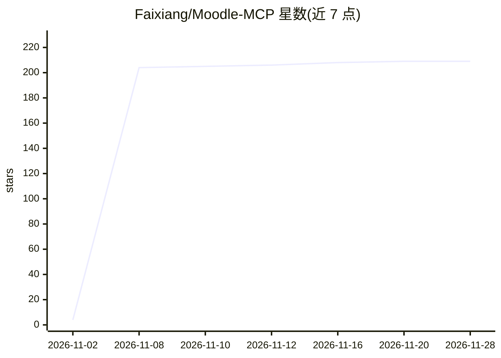

# Faixiang/Moodle-MCP

⭐ 209 · Python · MIT · 推送 2026-11-01 · [GitHub](https://github.com/Faixiang/Moodle-MCP) · 个人维护 · 中文 README

**连接 Moodle API 的零依赖只读 MCP 服务器，供 AI 客户端调用**

单文件 Python 实现的 MCP 服务器，封装 Moodle Web Service REST API，向 Claude Desktop、Cursor、Marvis 等 MCP 客户端暴露 10 个只读工具：课程列表、作业与截止日期（按临期/逾期分类）、测验状态与成绩、文件元数据与按周下载、每周摘要等。仅用 Python 标准库，通过 stdio JSON-RPC 2.0 通信，串行调用并以 150ms 间隔规避 WAF 限流；代码中不存在提交、选课、编辑或删除端点。需 Moodle 3.x/4.x 开启 Web Services 及有效令牌，Turnitin 截止日期不可读。

## 筛选速览

| 维度 | 判定 | 备注 |
|---|---|---|
| AI 角色 | `ai-ecosystem` | LLM/agent 周边工具 |
| 许可风险 | `permissive` | MIT |
| 部署形态 | `library` | 以包/库形式分发 |
| 模型依赖 | — | README 未给出锁定关系 |
| 硬件要求 | — | 无带数字的原话,不猜 |
| 安装摩擦 | `low` | 无编译、无系统依赖或容器化 |
| 成熟度 | — | 结构信号不足 |

## 能力要点

- 零依赖单文件：仅 Python 标准库，python server.py 即可运行
- 10 个只读工具覆盖课程、作业截止日期、测验状态与文件下载
- moodle_download_week 按周下载课件与作业附件并校验大小
- token 免装自检与配置引导工具（moodle_config_status / moodle_setup_guide）

## 适用场景

- 让学生用 Claude 或 Cursor 直接问本周还有哪些作业没交
- 通过 AI 客户端批量下载某周课程文件与作业附件
- 获取每周课程更新、截止日期与逾期情况的汇总简报

## 场景标签

 · 领域:教育/LMS 工具接入

## 证据(README 行号)

> L5: ### Your Moodle, as tools an AI agent can actually use
> L63: - **stdio JSON-RPC 2.0** — drops into Claude Desktop, Cursor, Marvis or any MCP-compatible client

## 星数曲线

2026-11-02 4 → 2026-11-28 209（+205）

---
*卡片 v1 · prompt 1.4 · 生成 2026-11-17 · 置信度 mid · 依据 README sha `ee365f2f710c` · [字段定义](../../DATASET.md)*
