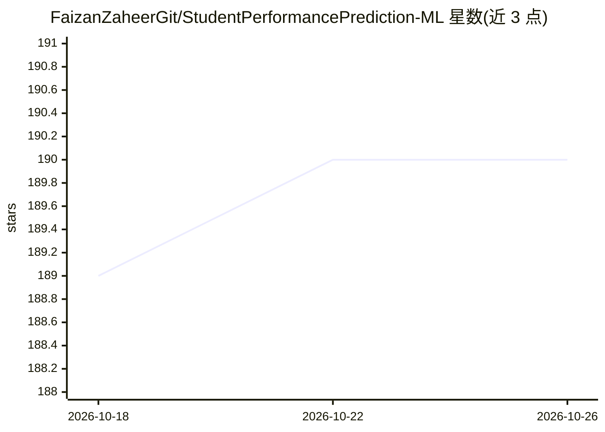

# FaizanZaheerGit/StudentPerformancePrediction-ML

⭐ 190 · Python · 推送 2025-10-31 · [GitHub](https://github.com/FaizanZaheerGit/StudentPerformancePrediction-ML) · 个人维护

**用多种分类器预测影响学生成绩因素的 ML 项目**

基于 CSV 学生数据集的机器学习项目：数据包含国籍、年级、举手次数、出勤次数、学习时长等特征，训练多种分类器与 ML 模型预测哪些因素影响学生成绩。项目生成图表与混淆矩阵展示结果，并附热力图等图表演示数据建模过程。以 Python 实现，面向机器学习学习者与数据分析练习者。

## 筛选速览

| 维度 | 判定 | 备注 |
|---|---|---|
| AI 角色 | `ai-native` | 本体是模型或模型工具 |
| 许可风险 | `none` | — |
| 部署形态 | `None` |  |
| 模型依赖 | — | README 未给出锁定关系 |
| 硬件要求 | — | 无带数字的原话,不猜 |
| 安装摩擦 | `low` | 无编译、无系统依赖或容器化 |
| 成熟度 | — | 结构信号不足 |

## 能力要点

- 多种分类器与 ML 模型比较预测学生成绩影响因素
- 读取包含国籍、年级、出勤、学习时长等字段的 CSV 数据集
- 生成图表、混淆矩阵与热力图展示结果

## 适用场景

- 学习分类器在表格数据上的建模与比较流程
- 分析出勤、学习时长等因素与学生成绩的关系
- 用作数据科学课程或入门练习项目

## 场景标签

`数据分析` · 领域:效率与自动化

## 证据(README 行号)

> L7: And a few different classifiers and ML models have been used to get the most accurate predictions of which factors,
> L8: affect the marks of students.

## 星数曲线

2026-10-18 189 → 2026-10-26 190（+1）

---
*卡片 v1 · prompt 1.4 · 生成 2026-10-22 · 置信度 mid · 依据 README sha `c51314308875` · [字段定义](../../DATASET.md)*
