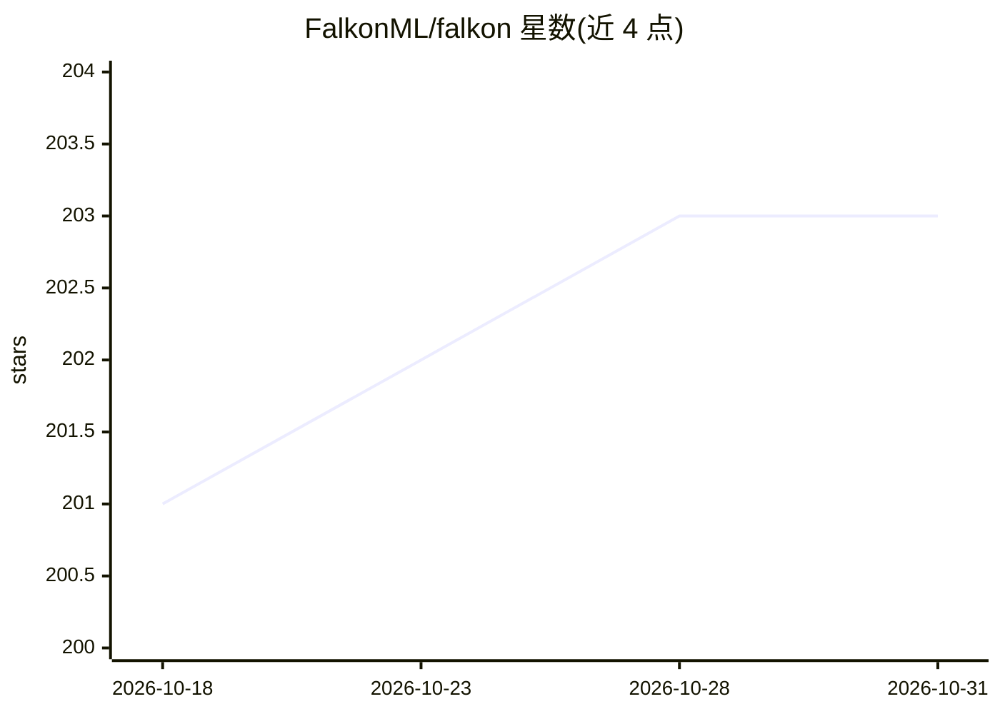

# FalkonML/falkon

⭐ 203 · Python · MIT · 推送 2026-10-14 · [GitHub](https://github.com/FalkonML/falkon) · [官网](https://falkonml.github.io/falkon/) · 组织维护

**面向大规模数据的近似核岭回归 Python 求解器**

Falkon 算法的 Python 实现，用于大规模近似核岭回归：基于 Nyström 近似，不显式计算完整核矩阵，配合预条件共轭梯度优化，可扩展到数千万级以上数据点。支持多 GPU（依赖 PyTorch），API 采用 sklearn 风格，仅需三个超参数（中心数 M、正则惩罚、核函数）。附带 falkon.hopt 模块做基于梯度的超参数自动优化。提供 pip 源码安装与针对多组 PyTorch+CUDA 组合的预编译 wheel；KeOps 加速为可选项，需 cmake 与 C++ 编译器。

## 筛选速览

| 维度 | 判定 | 备注 |
|---|---|---|
| AI 角色 | `ai-native` | 本体是模型或模型工具 |
| 许可风险 | `permissive` | MIT |
| 部署形态 | `library` | 以包/库形式分发 |
| 模型依赖 | — | README 未给出锁定关系 |
| 硬件要求 | — | 无带数字的原话,不猜 |
| 安装摩擦 | `medium` | 含编译或系统依赖之一 |
| 成熟度 | — | 结构信号不足 |

## 能力要点

- Nyström 近似 + 预条件共轭梯度的大规模核岭回归求解
- 不显式计算完整核矩阵，控制内存占用
- falkon.hopt 模块支持基于梯度的超参数自动优化（惩罚、核参数、中心）
- 提供多组 PyTorch+CUDA 组合的预编译 pip wheel，含 CPU-only 版本

## 适用场景

- 在数千万级样本上训练核岭回归模型
- 用 sklearn 风格 API 在现有代码中集成核方法
- 自动搜索核方法超参数而非手工调参

## 场景标签

`模型训练` · 领域:训练与推理

## 证据(README 行号)

> L3: Python implementation of the Falkon algorithm for large-scale, approximate kernel ridge regression.
> L5: The code is optimized for scalability to large datasets with tens of millions of points and beyond.
> L10: The basic algorithm is a Nyström approximation to kernel ridge regression, which needs only three hyperparameters:

## 星数曲线

2026-10-18 201 → 2026-10-31 203（+2）

---
*卡片 v1 · prompt 1.4 · 生成 2026-10-22 · 置信度 high · 依据 README sha `1bdda297e860` · [字段定义](../../DATASET.md)*
