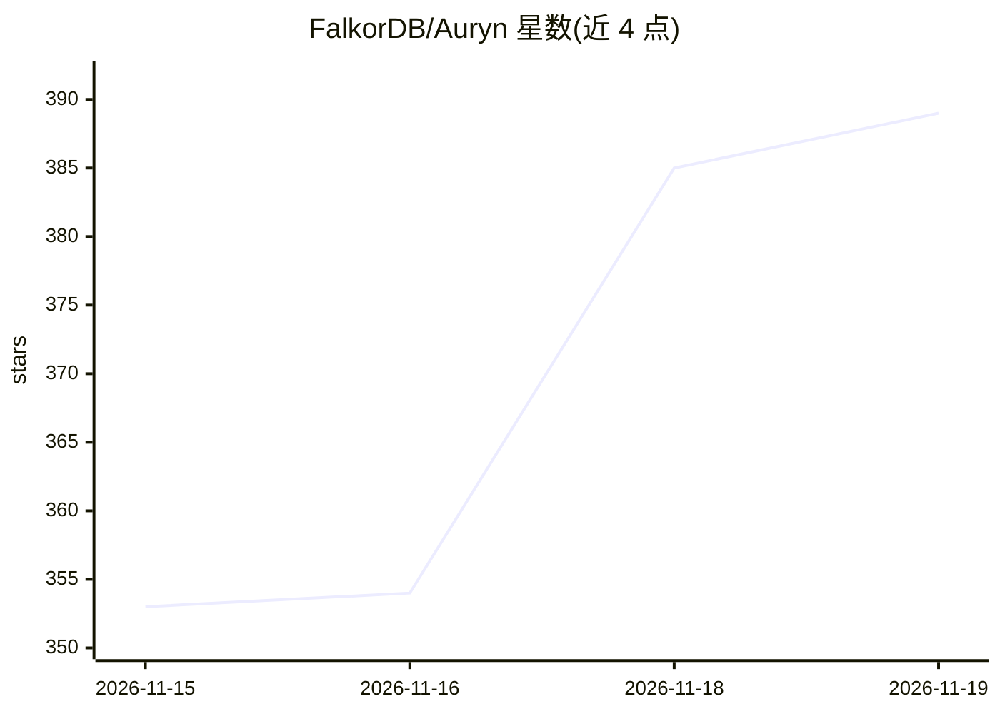

# FalkorDB/Auryn

⭐ 389 · Python · MIT · 推送 2026-11-18 · [GitHub](https://github.com/FalkorDB/Auryn) · [官网](https://falkordb.com/products/codegraph-auryn) · 组织维护

**把代码库转为可查询代码图，供编码 agent 经 MCP 遍历**

Auryn 将代码库解析为存于 FalkorDB 的代码图，节点与边覆盖函数、类型、表、端点及其 CALLS/EXTENDS 等关系，支持 16 种语言及 SQL/Oracle 模式自动检测。编码 agent 通过 MCP 调用其工具集（locate、who_calls、impact_of、find_path 等）做只读查询，回答附文件与行号引用。提供嵌入式 FalkorDB 免服务启动、增量重同步与本地查看器，可接入 Claude Code、Cursor 等多种 agent。

## 筛选速览

| 维度 | 判定 | 备注 |
|---|---|---|
| AI 角色 | `ai-ecosystem` | LLM/agent 周边工具 |
| 许可风险 | `permissive` | MIT |
| 部署形态 | `library` | 以包/库形式分发 |
| 模型依赖 | — | README 未给出锁定关系 |
| 硬件要求 | — | 无带数字的原话,不猜 |
| 安装摩擦 | `medium` | 含编译或系统依赖之一 |
| 成熟度 | — | 结构信号不足 |

## 能力要点

- 16 种语言 + SQL/Oracle 模式单次自动检测解析
- MCP 只读工具集：调用链、影响面、路径追踪、语义搜索
- 嵌入式 FalkorDB，零基础设施 quickstart，图持久化复用
- 增量重同步，commit 后仅重解析变更文件

## 适用场景

- 让编码 agent 回答调用关系与改动影响面并附行号引用
- 跨语言追踪一条请求从前端到数据库的路径
- 本地为代码库建立可查询知识图避免全库扫描

## 场景标签

`知识图谱` · 领域:知识与检索

## 证据(README 行号)

> L5: Auryn turns any codebase into a queryable codegraph in FalkorDB.
> L6: Your agent traverses it over MCP and answers from real structure, with file and line citations, instead of grepping 
> L35:     A -- MCP tools --> M[Auryn]

## 星数曲线

2026-11-15 353 → 2026-11-19 389（+36）

---
*卡片 v1 · prompt 1.4 · 生成 2026-11-17 · 置信度 high · 依据 README sha `385a8a9be426` · [字段定义](../../DATASET.md)*
