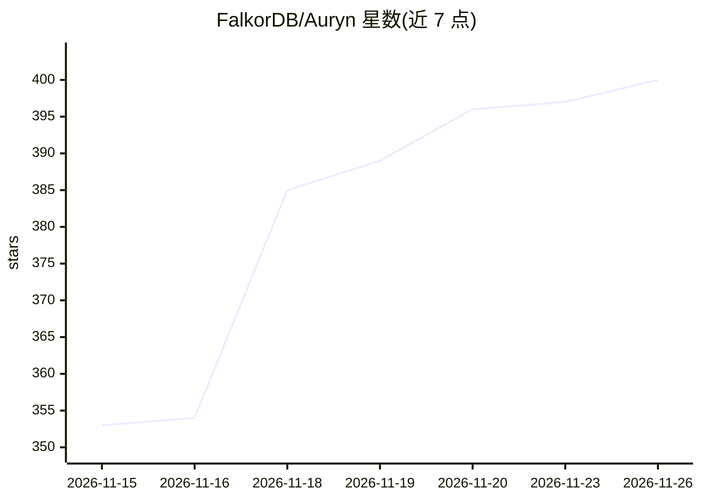

# FalkorDB/Auryn

⭐ 400 · Python · MIT · 推送 2026-11-25 · [GitHub](https://github.com/FalkorDB/Auryn) · [官网](https://falkordb.com/products/codegraph-auryn) · 组织维护

**把代码库构建为 FalkorDB 代码图谱供编码代理查询**

Auryn 将代码库解析为存于 FalkorDB 的代码图谱（函数、类型、表、端点及 CALLS/EXTENDS/READS/WRITES/DEPENDS_ON 等边），编码代理通过 MCP 工具查询：定位符号、N 跳调用方、影响范围、入口点闭包、路径查询与语义搜索，回答带 file:line 引用。支持 16 种语言加 SQL/Oracle 活库，提交后增量重同步仅重析变更文件，跨仓库引用自动链接。本地解析运行，需 Python ≥3.12，提供嵌入式 FalkorDB 或远程后端两种方式。

## 筛选速览

| 维度 | 判定 | 备注 |
|---|---|---|
| AI 角色 | `ai-ecosystem` | LLM/agent 周边工具 |
| 许可风险 | `permissive` | MIT |
| 部署形态 | `library` | 以包/库形式分发 |
| 模型依赖 | — | README 未给出锁定关系 |
| 硬件要求 | — | 无带数字的原话,不猜 |
| 安装摩擦 | `medium` | 含编译或系统依赖之一 |
| 成熟度 | — | 结构信号不足 |

## 能力要点

- 解析 16 种语言加 SQL，生成存于 FalkorDB 的代码图谱
- 通过 MCP 提供状态、索引、定位、调用方、影响范围、Cypher 查询等 10 余个工具
- 增量重同步仅重析变更文件及受影响代码
- 跨仓库引用在对方仓库入库后自动链接

## 适用场景

- 让编码代理回答'谁调用了这个函数/这次改动影响哪些端点'类结构问题
- 跨仓库、跨语言追踪一次请求从 UI 到数据库的完整链路
- 提交后增量刷新图谱，保持查询结果与代码同步

## 场景标签

`编码 Agent` `知识图谱` · 领域:编码与开发

## 证据(README 行号)

> L37:     A -- MCP tools --> M[Auryn]
> L42: 1. **Parse.** Auryn reads every file and builds a codegraph of functions, types, tables and endpoints, plus the edg
> L17: **Claude Code** &nbsp;·&nbsp; **Codex** &nbsp;·&nbsp; **Cursor** &nbsp;·&nbsp; **Windsurf** &nbsp;·&nbsp; **GitHub 

## 星数曲线

2026-11-15 353 → 2026-11-26 400（+47）

---
*卡片 v1 · prompt 1.4 · 生成 2026-11-25 · 置信度 high · 依据 README sha `0b95815b4674` · [字段定义](../../DATASET.md)*
