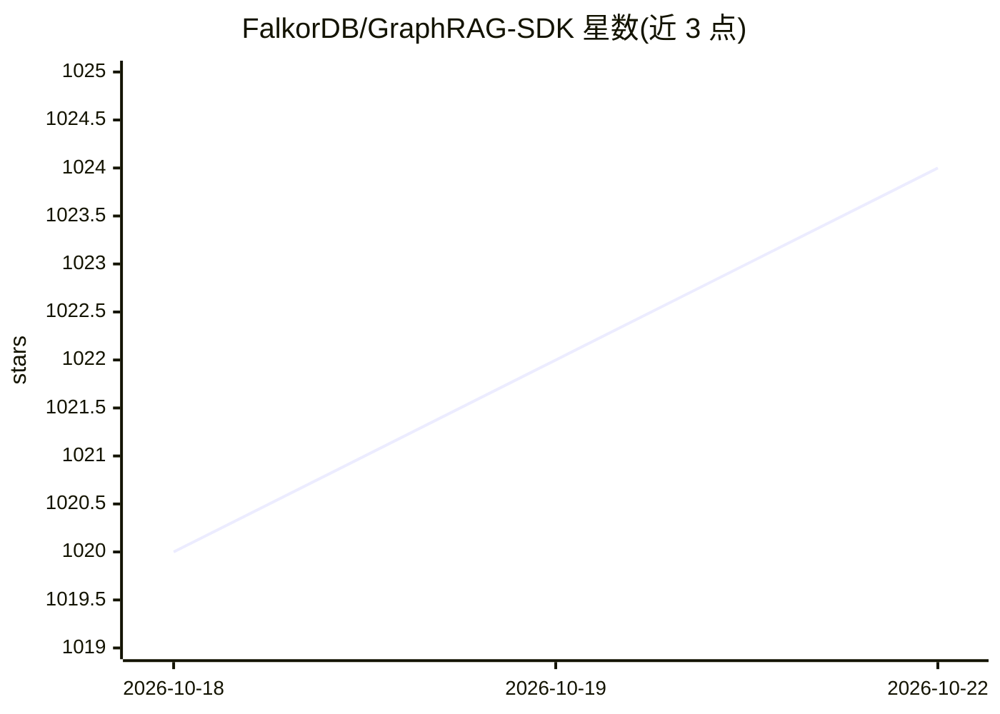

# FalkorDB/GraphRAG-SDK

⭐ 1,025 · Python · Apache-2.0 · 推送 2026-10-22 · [GitHub](https://github.com/FalkorDB/GraphRAG-SDK) · [官网](https://www.falkordb.com/) · 组织维护

**给开发者的 GraphRAG 框架：基于 FalkorDB 构建带溯源的 RAG 应用**

FalkorDB 维护的 Python GraphRAG SDK：把原始文档经实体/关系抽取构建知识图谱，检索阶段结合向量搜索、全文搜索、Text-to-Cypher 与关系扩展，输出可溯源到源文档块的回答；通过 MENTIONED_IN 溯源边与 return_context 支持应用侧校验生成声明并在证据不足时拒答。支持自定义 LLM/嵌入器接入（LiteLLM 通道）、本体定义与增量更新（update/delete_document/apply_changes）。安装需 pip 安装 SDK 并以 Docker 运行 FalkorDB，Python 3.10+，Apache 2.0 许可。

## 筛选速览

| 维度 | 判定 | 备注 |
|---|---|---|
| AI 角色 | `ai-ecosystem` | LLM/agent 周边工具 |
| 许可风险 | `permissive` | Apache-2.0 |
| 部署形态 | `self-host` | docker 或自建部署 |
| 模型依赖 | — | README 未给出锁定关系 |
| 硬件要求 | — | 无带数字的原话,不猜 |
| 安装摩擦 | `low` | 无编译、无系统依赖或容器化 |
| 成熟度 | — | 结构信号不足 |

## 能力要点

- 文档→知识图谱→带溯源回答的完整管线
- MENTIONED_IN 溯源边与证据不足时拒答机制
- 增量更新：update/delete_document/apply_changes 支持 CI 驱动的图同步
- 可插拔 LLM 与嵌入器，支持 PDF 摄取与本体定义

## 适用场景

- 构建基于知识图谱的问答系统并要求回答可溯源
- 在 CI 中随 PR 合并增量同步知识图谱
- 用自定义本体约束知识抽取，构建可校验的事实存储

## 场景标签

`RAG` `知识图谱` · 领域:知识与检索

## 证据(README 行号)

> L2:  The simplest, most accurate GraphRAG framework built on FalkorDB
> L70: pip install graphrag-sdk[litellm]

## 星数曲线

2026-10-18 1,020 → 2026-10-22 1,024（+4）

---
*卡片 v1 · prompt 1.4 · 生成 2026-10-21 · 置信度 high · 依据 README sha `d83bbd00361b` · [字段定义](../../DATASET.md)*
