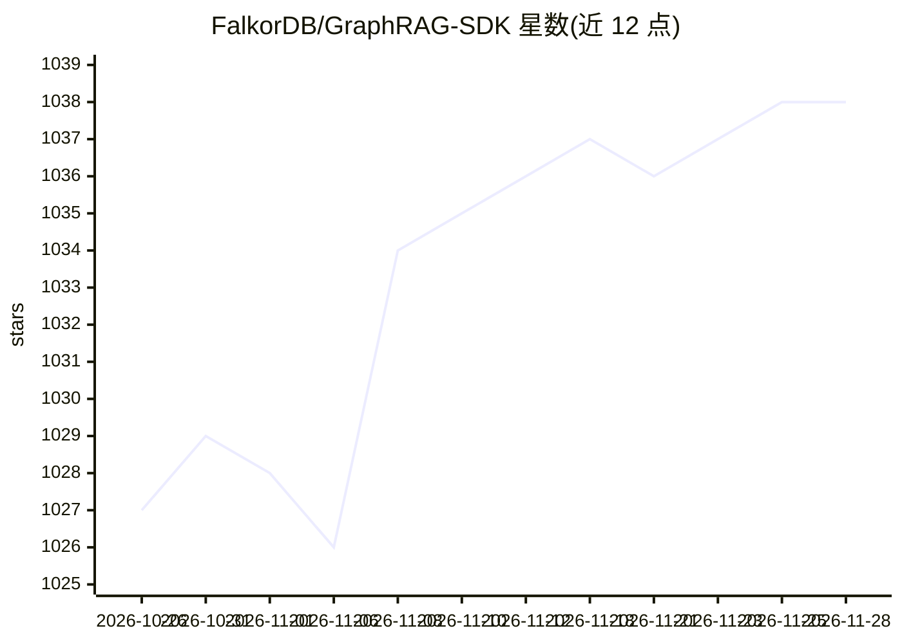

# FalkorDB/GraphRAG-SDK

⭐ 1,038 · Python · Apache-2.0 · 推送 2026-11-25 · [GitHub](https://github.com/FalkorDB/GraphRAG-SDK) · [官网](https://www.falkordb.com/) · 组织维护

**基于 FalkorDB 图数据库的 GraphRAG 开发框架**

FalkorDB 官方提供的 Python SDK，覆盖文档摄取（实体/关系抽取）、知识图谱构建、增量更新与多路径检索的完整 GraphRAG 流水线。检索结合向量搜索、全文搜索、Cypher 查询与关系扩展；通过 MENTIONED_IN 溯源边把实体关联到源文本块，支持应用在证据不足时拒绝生成。需运行 FalkorDB 4.20+ 服务器，LLM 调用经 LiteLLM 配置，PDF 摄取需额外 extras。

## 筛选速览

| 维度 | 判定 | 备注 |
|---|---|---|
| AI 角色 | `ai-ecosystem` | LLM/agent 周边工具 |
| 许可风险 | `permissive` | Apache-2.0 |
| 部署形态 | `self-host` | docker 或自建部署 |
| 模型依赖 | — | README 未给出锁定关系 |
| 硬件要求 | — | 无带数字的原话,不猜 |
| 安装摩擦 | `low` | 无编译、无系统依赖或容器化 |
| 成熟度 | — | 结构信号不足 |

## 能力要点

- 文档摄取→图谱构建→多路径检索的完整 GraphRAG 流水线
- MENTIONED_IN 溯源边与 return_context=True 提供检索链路检查
- 增量更新原语 update/delete_document/apply_changes，含幂等崩溃恢复
- 文本到 Cypher 检索（实验性）与面向 agent 的只读图工具

## 适用场景

- 把一批文档构建成知识图谱并提供带出处的问答
- 在 CI 中于 PR 合并时增量同步文档图谱
- 为自己的 agent 接入带证据编号的图检索工具

## 场景标签

`知识图谱` `RAG` `文档解析` · 领域:知识与检索

## 证据(README 行号)

> L2:  The simplest, most accurate GraphRAG framework built on FalkorDB
> L16: Most GraphRAG systems work in demos and break under production constraints. GraphRAG SDK was built from real deploy
> L70: pip install graphrag-sdk[litellm]

## 星数曲线

2026-10-26 1,027 → 2026-11-28 1,038（+11）

---
*卡片 v1 · prompt 1.4 · 生成 2026-11-25 · 置信度 high · 依据 README sha `dbb1cc3ab00c` · [字段定义](../../DATASET.md)*
