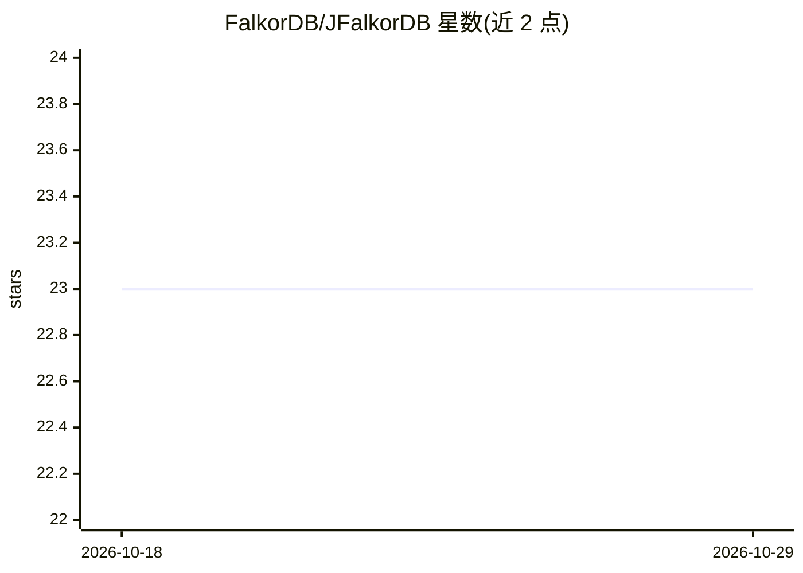

# FalkorDB/JFalkorDB

⭐ 23 · Java · BSD-3-Clause · 推送 2026-10-28 · [GitHub](https://github.com/FalkorDB/JFalkorDB) · [官网](https://www.falkordb.com/) · 组织维护

**FalkorDB 图数据库的 Java 客户端库**

FalkorDB（基于 Redis 协议的图数据库）的官方 Java 客户端：提供 Cypher 查询、管道与事务、UDF 加载和图管理等 API。连接配置可从环境变量解析（FALKORDB_URL/HOST/PORT、Sentinel 变量），默认 localhost:6379；自动探测 Redis Sentinel 与 Redis Cluster 端点并跟随故障转移与重新分片。内部基于 Jedis，可配置连接池、TLS 与凭据；库保持 Java 8 兼容，同时支持 JDK 21+ 虚拟线程并发及可选的 CompletableFuture 门面。通过 Maven Central 以依赖坐标安装。

## 筛选速览

| 维度 | 判定 | 备注 |
|---|---|---|
| AI 角色 | `ai-ecosystem` | LLM/agent 周边工具 |
| 许可风险 | `permissive` | BSD-3-Clause |
| 部署形态 | `None` |  |
| 模型依赖 | — | README 未给出锁定关系 |
| 硬件要求 | — | 无带数字的原话,不猜 |
| 安装摩擦 | `medium` | 含编译或系统依赖之一 |
| 成熟度 | — | 结构信号不足 |

## 能力要点

- Cypher 查询参数化编码以防注入，非法类型以 IllegalArgumentException 拒绝
- Sentinel 与 Redis Cluster 端点自动探测，跟随故障转移与重分片（最多重试三次）
- 环境变量驱动的连接配置，同一构件可跨 dev/CI/staging/prod 部署
- Java 8 兼容，同时支持 JDK 21+ 虚拟线程并发与可选 AsyncGraph 门面

## 适用场景

- 在 Java 服务中连接并查询 FalkorDB 图数据库
- 在 Redis Sentinel 或 Redis Cluster 部署下高可用访问图数据
- 用虚拟线程并发执行大量图查询

## 场景标签

`知识图谱` · 领域:知识与检索

## 证据(README 行号)

> L16: FalkorDB Java client
> L239: You can customize the connection pool to optimize performance and resource usage. JFalkorDB uses Jedis internally,

## 星数曲线

2026-10-18 23 → 2026-10-29 23（+0）

---
*卡片 v1 · prompt 1.4 · 生成 2026-10-27 · 置信度 mid · 依据 README sha `276a6f55f357` · [字段定义](../../DATASET.md)*
