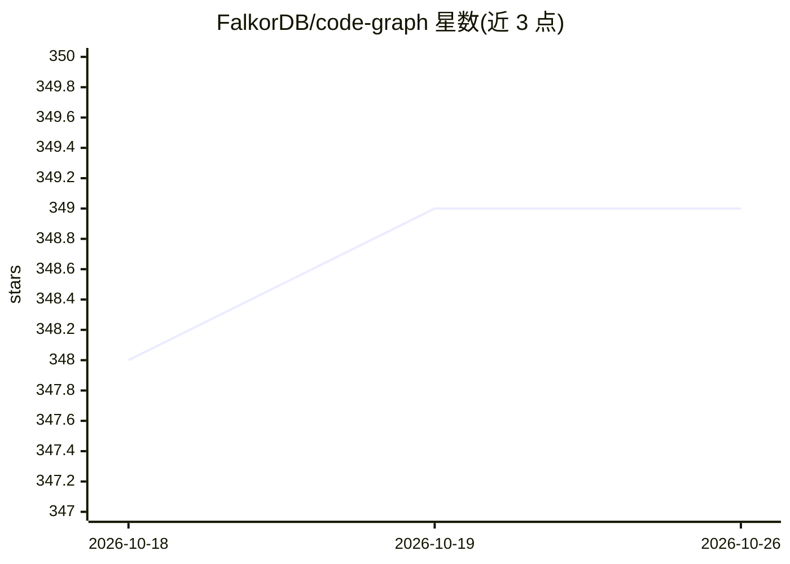

# FalkorDB/code-graph

⭐ 349 · Python · MIT · 推送 2026-10-23 · [GitHub](https://github.com/FalkorDB/code-graph) · [官网](https://code-graph.falkordb.com) · 组织维护

**把代码库索引为知识图谱的可视化与查询工具，供开发者与 AI agent 使用**

FalkorDB 出品的代码图谱应用：Python/FastAPI 后端加 React/Next.js 前端，将本地文件夹或 Git 仓库解析为知识图谱，支持依赖分析、邻居查询、路径查找与 commit 切换；当前启用 Python、Java、C# 分析器（C 分析器未注册）。数据存储于 FalkorDB 或嵌入式 FalkorDBLite。AI 能力包括基于 GraphRAG-SDK 与 LiteLLM 的对话问答端点（默认 Gemini 模型）、Claude Code 技能以及暴露 7 个工具的 stdio MCP server，供 Claude Code/Cursor/Cline 等 agent 调用。提供 PyPI CLI（cgraph）、Docker 与 Docker Compose 部署方式。

## 筛选速览

| 维度 | 判定 | 备注 |
|---|---|---|
| AI 角色 | `ai-enhanced` | 去掉 AI 部分产品仍成立 |
| 许可风险 | `permissive` | MIT |
| 部署形态 | `self-host` | docker 或自建部署 |
| 模型依赖 | — | README 未给出锁定关系 |
| 硬件要求 | — | 无带数字的原话,不猜 |
| 安装摩擦 | `low` | 无编译、无系统依赖或容器化 |
| 成熟度 | — | 结构信号不足 |

## 能力要点

- 将本地文件夹/Git 仓库索引为 FalkorDB 知识图谱并可视化
- CLI 工具 cgraph 从终端索引与查询图谱，输出 JSON
- stdio MCP server 暴露 index_repo、search_code、impact_analysis 等 7 个工具
- Claude Code 技能可自动处理索引与查询

## 适用场景

- 我想把整个代码库变成知识图谱，分析依赖与调用链
- 让 Claude Code/Cursor 等 agent 通过 MCP 直接查询代码结构
- 对代码图谱提问，定位函数间依赖路径

## 场景标签

`知识图谱` · 领域:知识与检索

## 证据(README 行号)

> L3: **Visualize codebases as knowledge graphs to analyze dependencies, detect bottlenecks, and optimize projects.**
> L287: |POST|`/api/chat`|Ask questions over the code graph via GraphRAG|
> L183: For agents that speak the Model Context Protocol

## 星数曲线

2026-10-18 348 → 2026-10-26 349（+1）

---
*卡片 v1 · prompt 1.4 · 生成 2026-10-22 · 置信度 low · 依据 README sha `ab53bf6620c9` · [字段定义](../../DATASET.md)*
