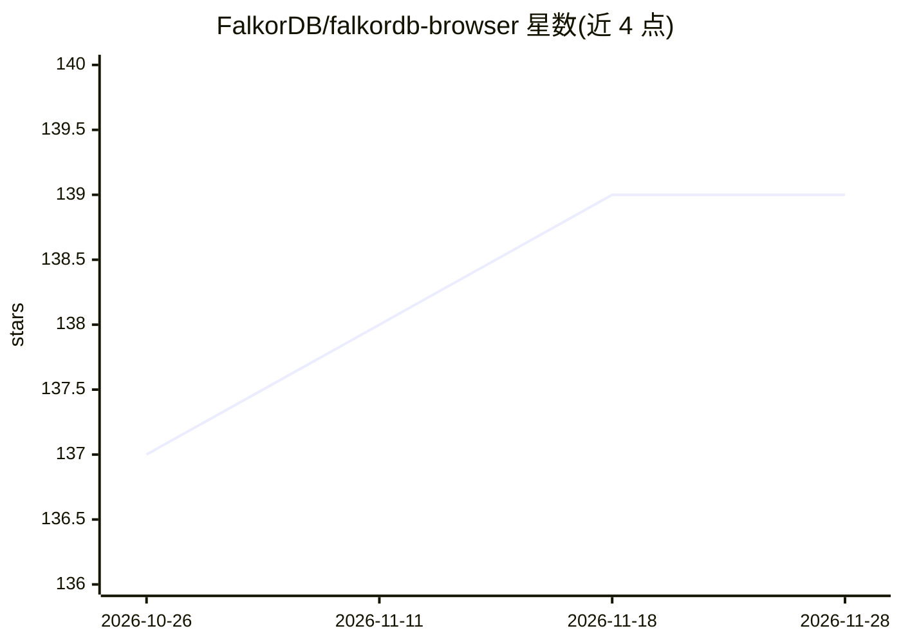

# FalkorDB/falkordb-browser

⭐ 139 · TypeScript · NOASSERTION · 推送 2026-11-26 · [GitHub](https://github.com/FalkorDB/falkordb-browser) · [官网](https://www.falkordb.com/) · 组织维护

**FalkorDB 图数据库的浏览器端查询可视化管理界面**

FalkorDB 的官方 Web 界面：连接数据库后可编写 Cypher 查询，结果以交互式 2D/3D 图或表格呈现，支持画布上就地增删改节点与关系、图的管理与 CSV 导入、用户与角色等服务器管理。可选启用 AI 辅助：自然语言转 Cypher 聊天、Fix with AI 与查询优化，可接 OpenAI、Groq、xAI、Ollama 或 LM Studio 模型。以 Docker 镜像、Kubernetes Helm、桌面应用、移动 shell 或源码方式运行，许可为 SSPL v1。

## 筛选速览

| 维度 | 判定 | 备注 |
|---|---|---|
| AI 角色 | `ai-enhanced` | 去掉 AI 部分产品仍成立 |
| 许可风险 | `none` | NOASSERTION |
| 部署形态 | `self-host` | docker 或自建部署 |
| 模型依赖 | local-ok | 支持本地模型 |
| 硬件要求 | — | 无带数字的原话,不猜 |
| 安装摩擦 | `low` | 无编译、无系统依赖或容器化 |
| 成熟度 | — | 结构信号不足 |

## 能力要点

- Cypher 编辑器：语法高亮、自动补全、内联诊断与查询历史
- 交互式 2D/3D 图画布，可按标签筛选与样式化节点
- 可选 AI 辅助：自然语言转 Cypher、Fix with AI、Optimize，支持 OpenAI/Groq/xAI/Ollama/LM Studio
- 多种部署形态：Docker、Kubernetes Helm、桌面安装包、移动 shell

## 适用场景

- 为 FalkorDB 图数据库编写并可视化探索 Cypher 查询结果
- 在画布上直接编辑节点与关系、导入 CSV 数据
- 用自然语言生成 Cypher 查询并获得修复与优化建议
- 在 Kubernetes 集群中部署图数据库管理界面

## 场景标签

`知识图谱` · 领域:知识与检索

## 证据(README 行号)

> L20: FalkorDB Browser is the web interface for FalkorDB. Connect to a database, write Cypher,
> L36: - **AI assistance (optional).** Chat (English to Cypher), **Fix with AI** and **Optimize**, with
> L22: server, all from one place. It runs as a Docker image, on Kubernetes, as a desktop app or

## 星数曲线

2026-10-26 137 → 2026-11-28 139（+2）

---
*卡片 v1 · prompt 1.4 · 生成 2026-11-27 · 置信度 high · 依据 README sha `9d70eb1b1807` · [字段定义](../../DATASET.md)*
