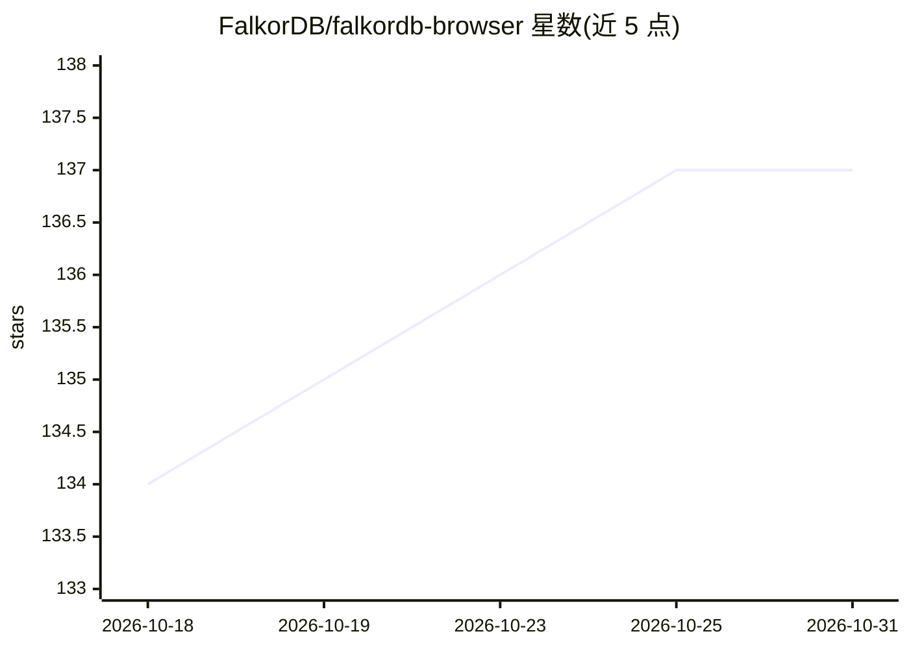

# FalkorDB/falkordb-browser

⭐ 137 · TypeScript · NOASSERTION · 推送 2026-10-29 · [GitHub](https://github.com/FalkorDB/falkordb-browser) · [官网](https://www.falkordb.com/) · 组织维护

**FalkorDB 图数据库的可视化管理界面（含 AI 修错）**

面向 FalkorDB 图数据库的 Web 可视化与管理界面：交互式创建图、运行 Cypher 查询、查询历史面板、节点样式自定义、CSV 上传导入（支持 MinIO/S3 与本地存储后端）。查询报错时提供静态提示、"Did you mean" 建议，并可配置 OpenAI/Groq/xAI/Ollama/LM Studio 等 OpenAI 兼容模型后，点击 "Fix with AI" 获取解释与修正查询。支持 Docker 单容器或分离部署、Helm 部署到 Kubernetes，以及 Node.js 20+ 源码运行；预配置连接可将凭据留在服务端并支持限流与 TLS。

## 筛选速览

| 维度 | 判定 | 备注 |
|---|---|---|
| AI 角色 | `ai-enhanced` | 去掉 AI 部分产品仍成立 |
| 许可风险 | `none` | NOASSERTION |
| 部署形态 | `self-host` | docker 或自建部署 |
| 模型依赖 | — | README 未给出锁定关系 |
| 硬件要求 | — | 无带数字的原话,不猜 |
| 安装摩擦 | `low` | 无编译、无系统依赖或容器化 |
| 成熟度 | — | 结构信号不足 |

## 能力要点

- 交互式图创建、查询与历史面板、节点样式自定义
- 查询错误的静态提示与 "Fix with AI"（OpenAI 兼容后端）
- CSV 导入支持 S3/MinIO 与本地存储后端
- Docker / Helm / 源码多种部署方式与预配置连接

## 适用场景

- 可视化管理与监控 FalkorDB 图数据
- 调试和迭代 Cypher 查询并获得纠错提示
- 通过 CSV 导入批量构建图数据

## 场景标签

`知识图谱` · 领域:知识与检索

## 证据(README 行号)

> L11: ## Visualize, manipulate and manage FalkorDB graph data interactively to monitor and explore data changes. The late
> L249: AI"** button (shown only when a supported OpenAI-compatible model — OpenAI/Groq/xAI/Ollama/
> L250: LM Studio — is configured) sends the **query and its error** to your configured provider on an

## 星数曲线

2026-10-18 134 → 2026-10-31 137（+3）

---
*卡片 v1 · prompt 1.4 · 生成 2026-10-23 · 置信度 high · 依据 README sha `b1698a9e3a88` · [字段定义](../../DATASET.md)*
