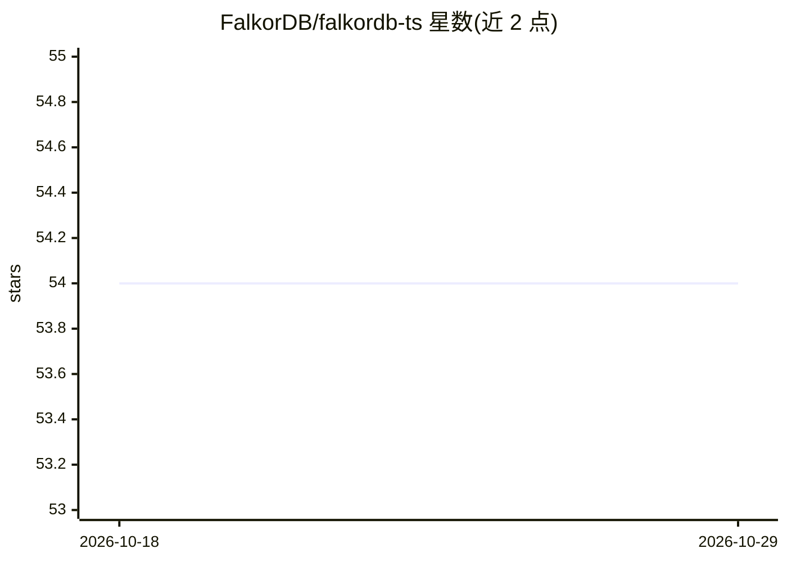

# FalkorDB/falkordb-ts

⭐ 54 · TypeScript · MIT · 推送 2026-10-26 · [GitHub](https://github.com/FalkorDB/falkordb-ts) · [官网](https://www.falkordb.com/) · 组织维护

**FalkorDB 图数据库的 Node.js/TypeScript 客户端库**

npm 发布的 falkordb 包，为 Node.js 提供 FalkorDB 图数据库的连接与操作接口：支持 host/port、连接 URL 与基于 node-redis 的 socket 选项（TLS、超时、keep-alive），执行 Cypher 查询；另含 .stubs() 查询已卸载到磁盘的图（依赖 FalkorDB Enterprise 图卸载模块，集群下合并各主节点回复）、.close() 立即断连等接口。面向在 TypeScript/Node.js 项目中接入 FalkorDB 的开发者，MIT 许可。

## 筛选速览

| 维度 | 判定 | 备注 |
|---|---|---|
| AI 角色 | `ai-ecosystem` | LLM/agent 周边工具 |
| 许可风险 | `permissive` | MIT |
| 部署形态 | `self-host` | docker 或自建部署 |
| 模型依赖 | — | README 未给出锁定关系 |
| 硬件要求 | — | 无带数字的原话,不猜 |
| 安装摩擦 | `low` | 无编译、无系统依赖或容器化 |
| 成熟度 | — | 结构信号不足 |

## 能力要点

- TypeScript API 连接 FalkorDB 并执行 Cypher 查询
- 多级连接配置：host/port、URL 与底层 node-redis socket 选项（TLS/超时/keep-alive）
- .stubs() 列出卸载到磁盘的图（需 Enterprise 图卸载模块）
- 集群模式下合并各主节点回复，部分失败返回部分结果

## 适用场景

- 在 Node.js 服务中连接并查询 FalkorDB 图数据库
- 管理图数据的连接配置（TLS、超时等）
- 检查集群中已卸载与在内存中的图

## 场景标签

`知识图谱` · 领域:知识与检索

## 证据(README 行号)

> L11: `falkordb` is a FalkorDB client for Node.js.

## 星数曲线

2026-10-18 54 → 2026-10-29 54（+0）

---
*卡片 v1 · prompt 1.4 · 生成 2026-10-24 · 置信度 low · 依据 README sha `ed13457e309e` · [字段定义](../../DATASET.md)*
