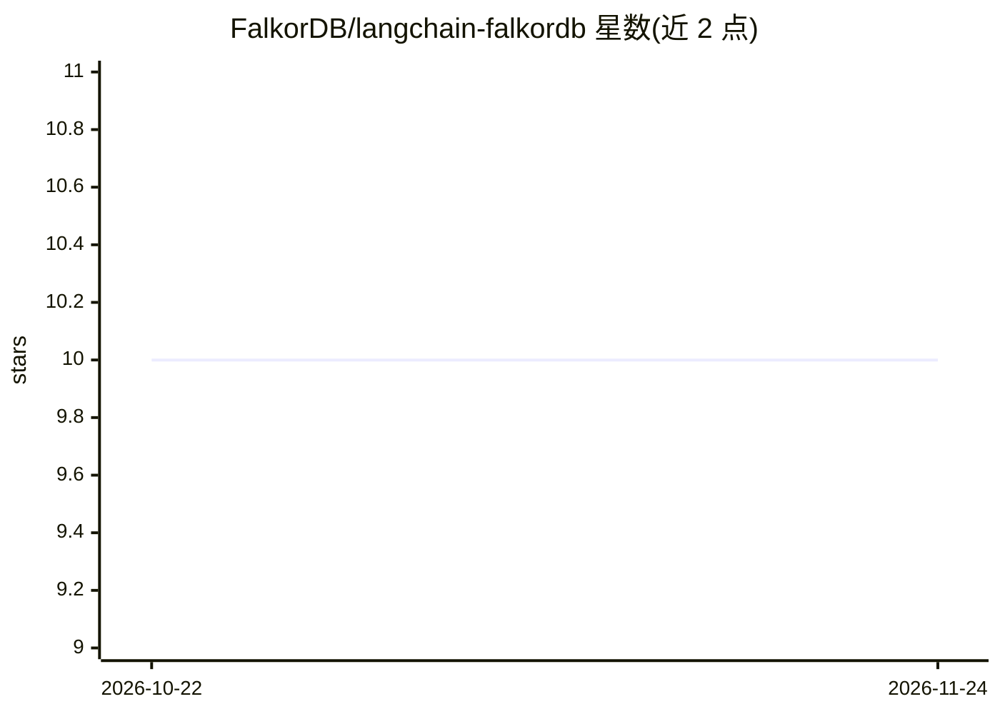

# FalkorDB/langchain-falkordb

⭐ 10 · Python · MIT · 推送 2026-11-17 · [GitHub](https://github.com/FalkorDB/langchain-falkordb) · [官网](https://www.falkordb.com/) · 组织维护

**FalkorDB 图数据库的 LangChain 集成包**

该包将 FalkorDB（带原生向量与全文索引的低延迟图数据库）接入 LangChain 生态，提供五个组件：图包装器 FalkorDBGraph（schema 自省与 GraphDocument 摄入）、向量存储 FalkorDBVector（元数据过滤、MMR、混合检索）、自然语言转 Cypher 的 QA 链、LangGraph 状态检查点器以及聊天历史持久化。通过 pip 安装，运行需一个 FalkorDB 实例（Docker 或 Cloud），支持用户名/密码与 SSL 认证。

## 筛选速览

| 维度 | 判定 | 备注 |
|---|---|---|
| AI 角色 | `ai-ecosystem` | LLM/agent 周边工具 |
| 许可风险 | `permissive` | MIT |
| 部署形态 | `self-host` | docker 或自建部署 |
| 模型依赖 | — | README 未给出锁定关系 |
| 硬件要求 | — | 无带数字的原话,不猜 |
| 安装摩擦 | `low` | 无编译、无系统依赖或容器化 |
| 成熟度 | — | 结构信号不足 |

## 能力要点

- 向量存储支持元数据过滤、MMR 搜索与向量+全文混合检索
- FalkorDBQAChain 将自然语言转 Cypher 查询图数据库
- FalkorDBSaver 将 LangGraph agent 状态持久化到 FalkorDB
- 聊天历史按 session_id 分图隔离存储

## 适用场景

- 用 LangChain 构建基于图数据库的 GraphRAG 检索
- 为 LangGraph agent 提供跨进程持久化的状态存储
- 对已有知识图谱做自然语言问答
- 在 FalkorDB 中保存多会话聊天记录

## 场景标签

`知识图谱` `RAG` `Agent 记忆` · 领域:Agent 开发

## 证据(README 行号)

> L12: This package contains the LangChain
> L13: integration for FalkorDB, a low-latency graph
> L25: - **`FalkorDBQAChain`** — a natural-language-to-Cypher question-answering

## 星数曲线

2026-10-22 10 → 2026-11-24 10（+0）

---
*卡片 v1 · prompt 1.4 · 生成 2026-11-20 · 置信度 high · 依据 README sha `e17f27cb4d31` · [字段定义](../../DATASET.md)*
