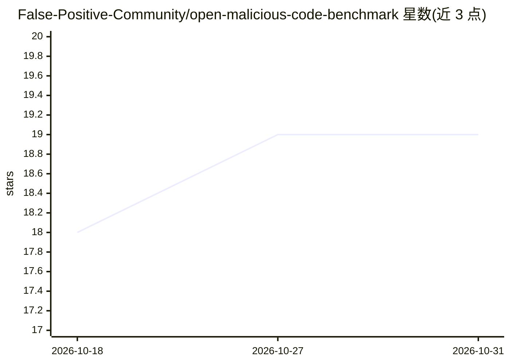

# False-Positive-Community/open-malicious-code-benchmark

⭐ 19 · Python · BSD-2-Clause · 推送 2026-06-09 · [GitHub](https://github.com/False-Positive-Community/open-malicious-code-benchmark) · 组织维护

**恶意代码检测评测基准：800 个带标签的 Python/JS 包数据集**

OMCBench 是一个评测恶意代码检测能力的基准套件：包含 800 个带标签的 Python 与 JavaScript 包（每语言各 400 个良性、400 个恶意），以子进程方式运行 OSSGadget BackdoorRules、bandit4mal、Semgrep 三个开源扫描器，解析输出为统一预测格式并计算 Precision/Recall/F1/ROC-AUC，另附 MOLOT System Card 白皮书（模型不公开，仅公布指标）。提供 CLI 与 bootstrap 置信区间计算；扫描器需按固定版本另行安装。良包按宽松许可从 PyPI/npm 高下载量集合采样，恶意包来自公开恶意软件源。

## 筛选速览

| 维度 | 判定 | 备注 |
|---|---|---|
| AI 角色 | `ai-knowledge` | 知识聚合/清单类 |
| 许可风险 | `permissive` | BSD-2-Clause |
| 部署形态 | `library` | 以包/库形式分发 |
| 模型依赖 | — | README 未给出锁定关系 |
| 硬件要求 | — | 无带数字的原话,不猜 |
| 安装摩擦 | `medium` | 含编译或系统依赖之一 |
| 成熟度 | — | 结构信号不足 |

## 能力要点

- 800 个带标签包（py/js 各 400）构成可复现评测集
- 以子进程运行三种扫描器并解析为统一预测格式
- 包级与文件级双粒度指标，含 bootstrap 置信区间（recompute-ci）
- 内置分层采样器与详细 caveat（超时处理、安装钩子类恶意向量）

## 适用场景

- 评测和对比恶意代码扫描工具的检测精度
- 复现已发布的基准结果或用自建 manifest 重跑
- 为供应链安全研究提供带标签的良/恶意包数据集

## 场景标签

`模型评测` `网络安全` · 领域:评测与运维

## 证据(README 行号)

> L14: **OMCBench** is a benchmark suite for evaluating malicious-code detection
> L15: capabilities. The benchmark consists of a labeled set of 800 Python and
> L301: malware feeds. Per-file labels combine expert annotation and LLM

## 星数曲线

2026-10-18 18 → 2026-10-31 19（+1）

---
*卡片 v1 · prompt 1.4 · 生成 2026-10-29 · 置信度 high · 依据 README sha `2dac4295c6f0` · [字段定义](../../DATASET.md)*
