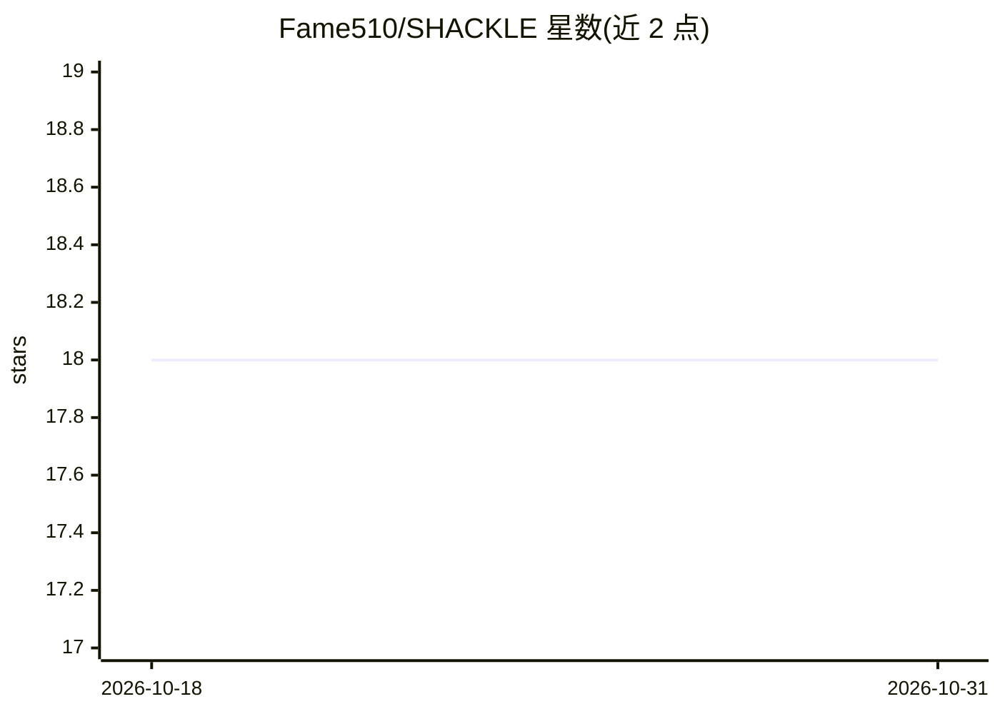

# Fame510/SHACKLE

⭐ 18 · Python · AGPL-3.0 · 推送 2026-10-24 · [GitHub](https://github.com/Fame510/SHACKLE) · [官网](https://fame510.github.io/SHACKLE/) · 个人维护

**自治 AI agent 的治理守护库：限制循环、预算与超时**

进程内 Python 治理层（pyshackle），为 CrewAI、LangChain/LangGraph、AutoGen 等框架的 agent 工作流附加四类熔断：重复工具调用（默认 3 次）、估算花费超限（默认 $0.20）、超时（默认 180 秒）与总调用数上限（默认 50 次），支持操作员介入（HITL）。通过 LiteLLM 双层拦截与 CrewAI 原生钩子实现覆盖，Guard(strict=True) 可在检测到覆盖缺口时拒绝启动；v2 提供独立 sidecar 守护进程与 Ed25519 签名审计日志。成本为本地价格表估算，不保证与账单一致；覆盖率依赖框架路径。

## 筛选速览

| 维度 | 判定 | 备注 |
|---|---|---|
| AI 角色 | `ai-ecosystem` | LLM/agent 周边工具 |
| 许可风险 | `dual` | AGPL-3.0 |
| 部署形态 | `library` | 以包/库形式分发 |
| 模型依赖 | — | README 未给出锁定关系 |
| 硬件要求 | — | 无带数字的原话,不猜 |
| 安装摩擦 | `low` | 无编译、无系统依赖或容器化 |
| 成熟度 | — | 结构信号不足 |

## 能力要点

- 四类熔断器：重复调用/预算/超时/总调用数，可拒绝、暂停或中止
- 模型感知定价解析（含 provider 前缀与日期变体），未知模型回退默认行并告警
- LiteLLM 双层拦截 + CrewAI 原生钩子，Guard(strict=True) 覆盖缺口检测
- 发布 SP/1.0 版本化调解契约与哈希固定的 82 例公开测试画像

## 适用场景

- 防止 agent 陷入重复工具调用循环烧掉上下文和 API 费用
- 为 LLM 工作流设置花费预算与执行时长上限
- 生产环境通过 v2 sidecar 获得分布式预算状态与签名审计日志

## 场景标签

`LLM 可观测性` · 领域:评测与运维

## 证据(README 行号)

> L39: SHACKLE is an in-process Python governance layer with a separate v2 sidecar option. `Guard` tracks execution state 
> L85: ## 🔌 Works With
> L89: |**CrewAI**|Native before-tool / before-LLM / after-LLM hooks, plus detected tool/agent hooks|Verified against the 

## 星数曲线

2026-10-18 18 → 2026-10-31 18（+0）

---
*卡片 v1 · prompt 1.4 · 生成 2026-10-29 · 置信度 high · 依据 README sha `f05fe552b383` · [字段定义](../../DATASET.md)*
