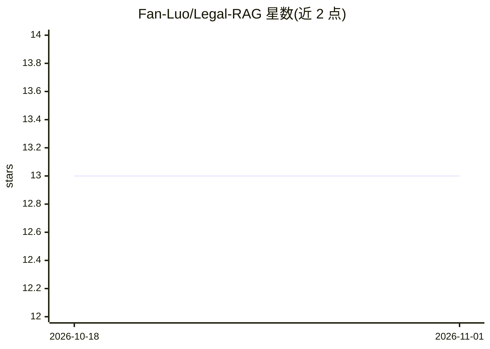

# Fan-Luo/Legal-RAG

⭐ 13 · Python · NOASSERTION · 推送 2026-02-16 · [GitHub](https://github.com/Fan-Luo/Legal-RAG) · 个人维护 · 中文 README

**面向法律文本的图增强 RAG 问答系统，支持混合检索与路由**

以法条文本为中心的端到端法律 RAG 系统：条文级切块并附章节条号元数据，检索层融合 FAISS 稠密、BM25 稀疏与 ColBERT 晚期交互；路由器在纯检索与图辅助 RAG 间切换，内置轻量 law_graph 结构推理。支持在线 PDF 上传的增量索引（FAISS 增量、BM25 后台重建）。生成层 provider 无关：默认本地 Qwen（需 GPU），或 OpenAI 兼容 API（key 仅从环境变量读取），无 key 且无本地模型时优雅降级。面向研究 RAG 架构的工程师、法律 NLP 研究者，内置中文民法典与英文 UCC 语料。仅供教育研究用途，不构成法律意见。

## 筛选速览

| 维度 | 判定 | 备注 |
|---|---|---|
| AI 角色 | `ai-native` | 本体是模型或模型工具 |
| 许可风险 | `none` | NOASSERTION |
| 部署形态 | `library` | 以包/库形式分发 |
| 模型依赖 | — | README 未给出锁定关系 |
| 硬件要求 | — | 无带数字的原话,不猜 |
| 安装摩擦 | `low` | 无编译、无系统依赖或容器化 |
| 成熟度 | — | 结构信号不足 |

## 能力要点

- FAISS+BM25+ColBERT 加权融合的混合检索
- QueryType-aware 路由：纯检索 vs 图辅助 RAG
- 中英文语料级语言路由（民法典/UCC）
- 在线 PDF 上传→增量索引
- LLM 后端可选（本地 Qwen / OpenAI 兼容 API），无配置时优雅降级

## 适用场景

- 搭建基于法条的法律问答系统
- 研究图增强 RAG 与检索路由架构
- 上传法律 PDF 增量构建可审计的检索索引

## 场景标签

`RAG` `文档问答` · 领域:知识与检索

## 证据(README 行号)

> L16: Legal-RAG is an open-source, end-to-end legal Retrieval-Augmented Generation (RAG) system centered on statutory tex
> L65: 4. Online Serving (RAG + Routing)
> L122: - OpenAI-compatible API (need to provide OpenAI API key)

## 星数曲线

2026-10-18 13 → 2026-11-01 13（+0）

---
*卡片 v1 · prompt 1.4 · 生成 2026-10-31 · 置信度 mid · 依据 README sha `26f717a6fca9` · [字段定义](../../DATASET.md)*
