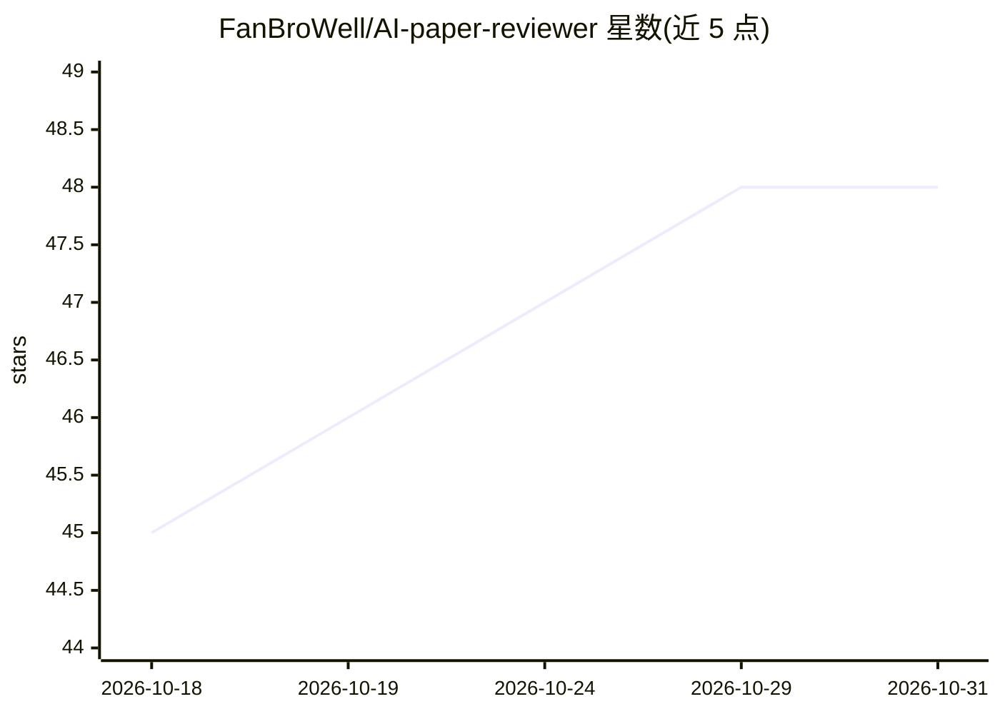

# FanBroWell/AI-paper-reviewer

⭐ 48 · Python · MIT · 推送 2026-10-30 · [GitHub](https://github.com/FanBroWell/AI-paper-reviewer) · 个人维护 · 中文 README

**顶会论文投稿前自审的 prompt 工具箱（Claude/ChatGPT 可用）**

面向 NeurIPS/ICML/ICLR/AAAI/KDD 投稿场景的自审 prompt 集合：14 个 Markdown prompt 文件覆盖主审工作流、段落级精细审查、章节专项、双盲合规扫描、BibTeX 转换、符号一致性、reproducibility checklist、rebuttal 起草等。使用方式为将 prompt 复制到 Claude/ChatGPT/Gemini/Codex 对话框，再粘贴论文段落获取审查与改写建议。框架包含 10 维度审查与 4 级红旗体系，附中英双语 prompt 文件与示例案例。

## 筛选速览

| 维度 | 判定 | 备注 |
|---|---|---|
| AI 角色 | `ai-knowledge` | 知识聚合/清单类 |
| 许可风险 | `permissive` | MIT |
| 部署形态 | `None` |  |
| 模型依赖 | — | README 未给出锁定关系 |
| 硬件要求 | — | 无带数字的原话,不猜 |
| 安装摩擦 | `low` | 无编译、无系统依赖或容器化 |
| 成熟度 | — | 结构信号不足 |

## 能力要点

- 14 个 prompt 文件覆盖工作流/章节专项/双盲扫描/rebuttal 等
- 10 维度审查框架与 4 级红旗体系
- 中英双语（prompts/ 与 prompts_en/）
- 21 项 NeurIPS/ICML reproducibility checklist 助手

## 适用场景

- 投稿前逐段自审论文的 claim、引用与数字一致性
- 扫描正文与 metadata 中的双盲泄露
- 起草 rebuttal 与填写可复现性问卷

## 场景标签

`提示工程` `科研工具` · 领域:Agent 开发

## 证据(README 行号)

> L7: 面向 NeurIPS、ICML、ICLR、AAAI、KDD 等顶会投稿场景的严格论文自审 prompt 工具箱。它帮助你在投稿前检查逻辑、claim、实验、引用、双盲匿名、可复现性和 rebuttal 风险。
> L29: AI-paper-reviewer 是一组可直接复制到 Claude / ChatGPT / Gemini / Codex 的 paper review prompts。它综合 **NeurIPS / ICML / ICLR / 

## 星数曲线

2026-10-18 45 → 2026-10-31 48（+3）

---
*卡片 v1 · prompt 1.4 · 生成 2026-10-25 · 置信度 high · 依据 README sha `ee906742338e` · [字段定义](../../DATASET.md)*
