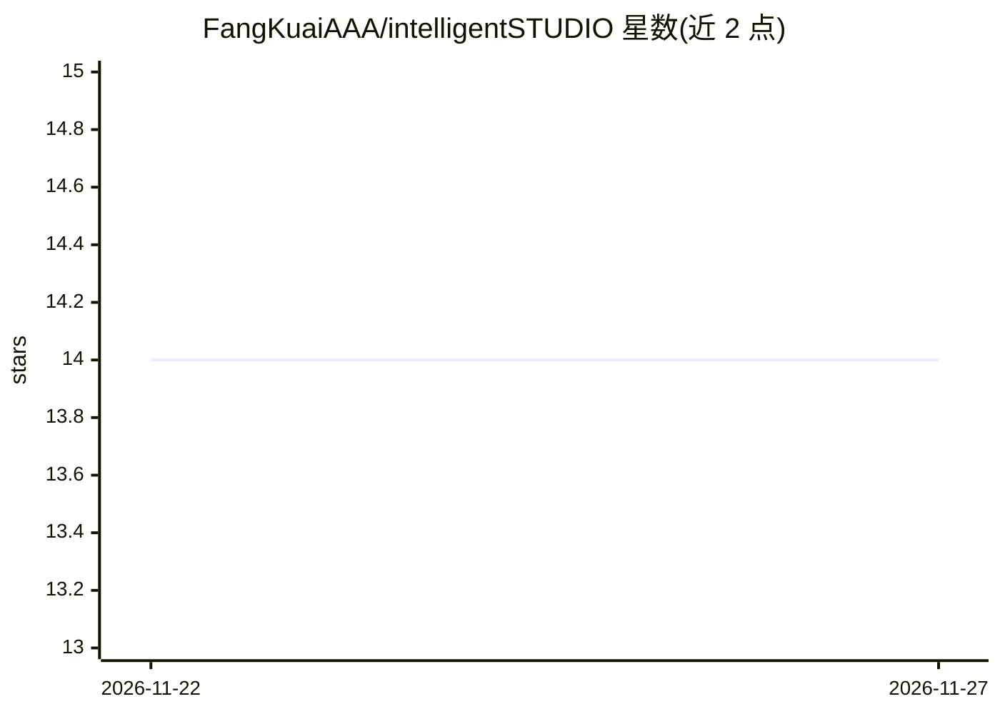

# FangKuaiAAA/intelligentSTUDIO

⭐ 14 · Python · GPL-3.0 · 推送 2026-11-08 · [GitHub](https://github.com/FangKuaiAAA/intelligentSTUDIO) · 个人维护 · 中文 README

**Windows 系统级 AI 助手，复刻苹果智能功能**

基于 Electron + Python + .NET 的 Windows 系统级 AI 助手，核心 Agent「Dony」通过 Function Calling 调用 Windows API、Shell、MCP 完成系统操作，优先走 UIA 控件树而非截图坐标点击，提供快速模式（5 次请求上限）与任务模式（40 次上限）两种 ReAct 执行路径。另含视觉智能、书写辅助、离线通知摘要（bge-small-zh + Qwen2.5-0.5B）、照片消除/扩展/3D 重构（SAM、SHARP）、Edge 扩展与 Office 插件。安装版内置全部运行时，仅需 Windows 10 21H2+ 与支持 DirectX 12 的显卡。

## 筛选速览

| 维度 | 判定 | 备注 |
|---|---|---|
| AI 角色 | `ai-native` | 本体是模型或模型工具 |
| 许可风险 | `viral` | GPL-3.0 |
| 部署形态 | `desktop` | 安装包/桌面程序 |
| 模型依赖 | — | README 未给出锁定关系 |
| 硬件要求 | — | 无带数字的原话,不猜 |
| 安装摩擦 | `medium` | 含编译或系统依赖之一 |
| 成熟度 | — | 结构信号不足 |

## 能力要点

- Dony Agent 以 UIA 语义控件树为首选执行路径，不依赖截图坐标定位
- 快速/任务双 ReAct 模式，分别限 5 次与 40 次模型请求
- 通知智能全部离线运行（bge-small-zh-v1.5 INT8 + Qwen2.5-0.5B INT4 ONNX）
- 照片消除依赖 SAM，单照片 3D 重构基于 SHARP 模型 + WebGPU 推理

## 适用场景

- 用自然语言让助手直接操作 Windows 系统设置、文件与应用
- 框选屏幕区域进行翻译、提取文字与物体识别
- 在 Word/Excel/PowerPoint 中使用书写辅助与配图生成
- 勿扰模式下只接收被判定为重要的通知提醒

## 场景标签

`AI 助手` `GUI 自动化` `AI 写作` `图像生成` · 领域:效率与自动化

## 证据(README 行号)

> L13: 类 Windows 系统级人工智能助手。将对话、视觉理解、写作、图像与通知能力深度融入 Windows 系统生态，提供接近原生系统能力的本地交互体验。
> L15: 核心助手名为 **Dony**——一个实时唤醒、可操作系统级任务的 Agent，支持快速模式与任务模式，优先通过 Windows API、Shell、MCP 等直接型操作完成任务，而非间接的 GUI 点击。
> L21: ||**Dony 系统级助手**|`Alt+Space` 唤醒键入模式、`Alt+D` 唤醒语音模式（通知中心菜单），唤醒动画为类似 Apple 智能的彩虹跑马灯；通过 Function Calling 调用工具，完成文件读写、应

## 星数曲线

2026-11-22 14 → 2026-11-27 14（+0）

---
*卡片 v1 · prompt 1.4 · 生成 2026-11-22 · 置信度 high · 依据 README sha `6b7cbde2d36f` · [字段定义](../../DATASET.md)*
