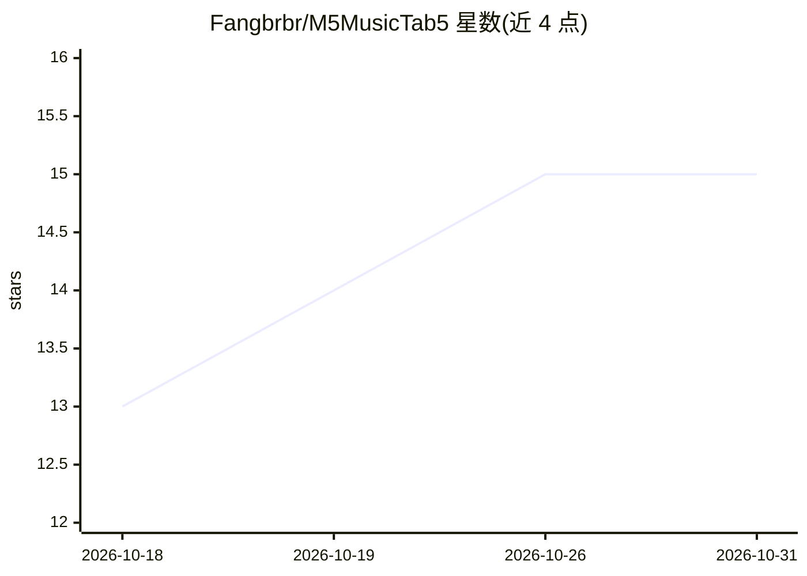

# Fangbrbr/M5MusicTab5

⭐ 15 · C · MIT · 推送 2026-09-08 · [GitHub](https://github.com/Fangbrbr/M5MusicTab5) · [官网](https://fangbrbr.github.io/M5MusicTab5/) · 个人维护 · 中文 README

**M5Stack Tab5 音乐探索终端固件，12 个音乐 App 加 AI 语音助手**

面向 M5Stack Tab5（ESP32-P4）开发的音乐探索终端固件，包含禅模式、练耳、和弦练习、小钢琴、音序器、播放器、节拍器、录音机等 12 个 App。音频侧基于 SoundFont 2 采样合成，支持 SD 卡加载自定义音色、MP3 播放、标准 MIDI 录制回放，以及 USB Host/蓝牙/UART 多路输入的全局 MIDI 总线。其他功能包括 FTP 无线管理 SD 卡文件、中英双语界面、实时时钟联网（天气/新闻/农历），以及基于小智的 AI 语音对话与 MCP 设备控制。固件通过网页烧录器或 GitHub Release 镜像刷入，无需本地工具链。

## 筛选速览

| 维度 | 判定 | 备注 |
|---|---|---|
| AI 角色 | `ai-enhanced` | 去掉 AI 部分产品仍成立 |
| 许可风险 | `permissive` | MIT |
| 部署形态 | `None` |  |
| 模型依赖 | — | README 未给出锁定关系 |
| 硬件要求 | — | 无带数字的原话,不猜 |
| 安装摩擦 | `low` | 无编译、无系统依赖或容器化 |
| 成熟度 | — | 结构信号不足 |

## 能力要点

- SF2 采样合成器，内置 GM 音色并支持 SD 卡加载自定义 SoundFont
- 全局 MIDI 总线（USB Host/蓝牙/UART 多路输入）与标准 SMF 录制回放
- 内置 FTP 服务器，局域网免拔卡管理 SD 卡文件
- 12 个内置 App 与中英双语界面，网页烧录器免工具链刷机

## 适用场景

- 在 Tab5 上练耳、练和弦、弹奏与录制 MIDI
- 接 USB/蓝牙 MIDI 键盘作为合成器音源使用
- 通过 AI 语音助手进行对话与设备控制
- 局域网 FTP 向设备传曲、换音色、取回录音

## 场景标签

`语音 Agent` · 领域:对话与助手

## 证据(README 行号)

> L24: - **12 个内置 App** — 禅模式 / 练耳 / 和弦练习（含五度圈）/ 小钢琴 / 音序器 / 播放器 / XY Pad / 节拍器 / AI 语音助手 / 时钟日历 / 趣味抽卡 / 录音机
> L32: - **小智 AI 语音 + MCP 设备控制** — 语音对话 + 设备控制

## 星数曲线

2026-10-18 13 → 2026-10-31 15（+2）

---
*卡片 v1 · prompt 1.4 · 生成 2026-10-30 · 置信度 high · 依据 README sha `9850e75a7995` · [字段定义](../../DATASET.md)*
