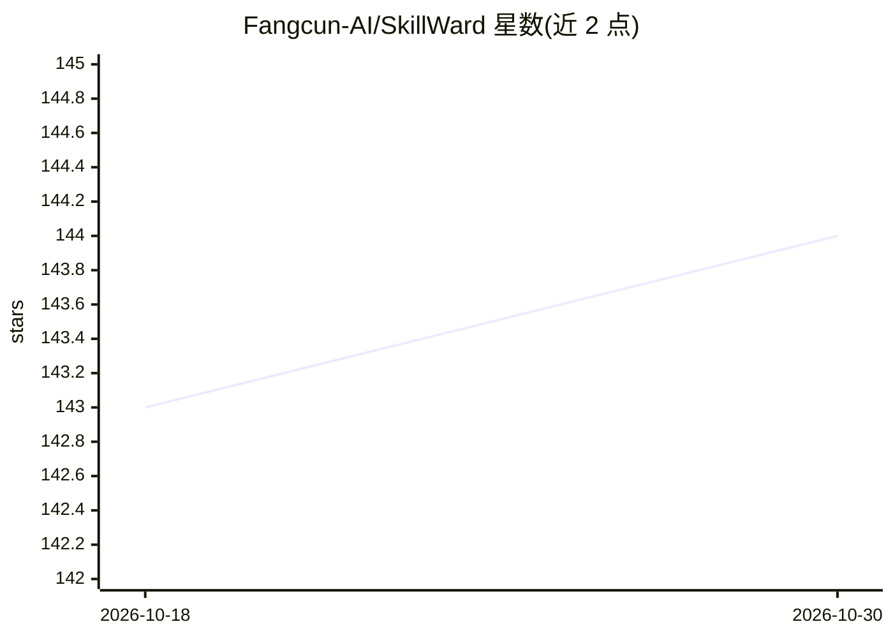

# Fangcun-AI/SkillWard

⭐ 144 · Python · NOASSERTION · 推送 2026-07-17 · [GitHub](https://github.com/Fangcun-AI/SkillWard) · [官网](https://skillward.fangcunleap.com/) · 组织维护 · 中文 README

**AI Agent Skills 安全扫描器：静态+LLM+沙箱三阶段检测风险**

面向 Agent Skill 发布/部署前的安全审查工具，采用三阶段流水线：Stage A 用 YARA 规则与正则做静态分析，Stage B 用 LLM 语义评估分诊，Stage C 在隔离 Docker 沙箱中端到端执行可疑 Skill，配合运行时 Guard 与蜜罐诱饵捕获凭据外泄、持久化后门等行为。提供 CLI 与 Web UI（单条/批量扫描、三种模式），可扫描 MCP 项目，已上架 Dify Marketplace。运行需 Python 3.10+，沙箱功能需 Docker，UI 需 Node.js 18+。

## 筛选速览

| 维度 | 判定 | 备注 |
|---|---|---|
| AI 角色 | `ai-ecosystem` | LLM/agent 周边工具 |
| 许可风险 | `none` | NOASSERTION |
| 部署形态 | `library` | 以包/库形式分发 |
| 模型依赖 | — | README 未给出锁定关系 |
| 硬件要求 | — | 无带数字的原话,不猜 |
| 安装摩擦 | `low` | 无编译、无系统依赖或容器化 |
| 成熟度 | — | 结构信号不足 |

## 能力要点

- 静态分析（YARA/正则）+ LLM 评估 + Docker 沙箱执行三阶段流水线
- 沙箱内运行时 Guard 监控与蜜罐诱饵，捕获凭据外泄、持久化后门等威胁
- 提供 CLI 与 Web UI，支持 Quick Scan / Sandbox Scan / Deep Trace 三种模式
- 支持 MCP 源、Git 仓库、压缩包及远程 MCP 服务器的安全扫描

## 适用场景

- 在部署前扫描 Agent Skill 是否含恶意行为
- 批量审查 Skill 市场/仓库中技能的安全性
- 在 Dify 工作流中集成 Skill 安全扫描产出结构化报告
- 通过 Claude Code 技能直接审计任意 Skill 压缩包

## 场景标签

`网络安全` · 领域:学习与行业

## 证据(README 行号)

> L12:  SkillWard is a security scanner for AI Agent Skills that combines static analysis, LLM evaluation, and sandbox ver
> L51: SkillWard uses a static + dynamic three-stage analysis approach:
> L133: **Requirements:** Python 3.10+ / Docker (sandbox) / Node.js 18+ (UI mode)

## 星数曲线

2026-10-18 143 → 2026-10-30 144（+1）

---
*卡片 v1 · prompt 1.4 · 生成 2026-10-23 · 置信度 mid · 依据 README sha `3a9479e43eec` · [字段定义](../../DATASET.md)*
