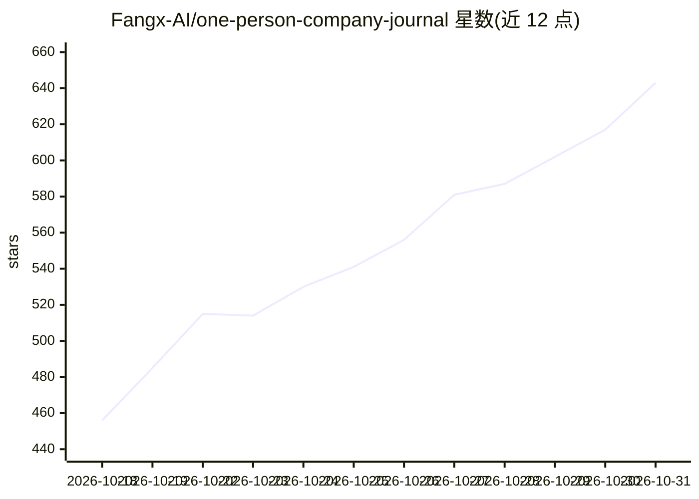

# Fangx-AI/one-person-company-journal

⭐ 643 · JavaScript · NOASSERTION · 推送 2026-10-30 · [GitHub](https://github.com/Fangx-AI/one-person-company-journal) · [官网](https://fxin.cc) · 个人维护 · 中文 README

**一人公司实践者的 AI 创业公开记录博客（192+ 篇）**

个人纪实内容仓库：作者方鑫以博客文章形式公开记录从零开始经营一人公司的过程，内容涉及产品开发（DeskFlow、Image2.fun 等）、网站运营、自媒体分发、小红书运营、AI 工具使用（Codex、OpenClaw、AI 剪辑、AI 生图）及收入复盘。README 本身为文章目录索引加作者信息，仓库标签含 react/typescript/vite，指向配套网站工程。不提供可安装运行的软件产品本体说明。

## 筛选速览

| 维度 | 判定 | 备注 |
|---|---|---|
| AI 角色 | `ai-knowledge` | 知识聚合/清单类 |
| 许可风险 | `none` | NOASSERTION |
| 部署形态 | `None` |  |
| 模型依赖 | — | README 未给出锁定关系 |
| 硬件要求 | — | 无带数字的原话,不猜 |
| 安装摩擦 | `low` | 无编译、无系统依赖或容器化 |
| 成熟度 | — | 结构信号不足 |

## 能力要点

- 按 No./Day/周报编号组织的 192+ 篇纪实文章目录
- 记录 AI 工具在产品开发、内容生产、剪辑生图中的使用
- 包含收入、流量、合规与踩坑的经营复盘

## 适用场景

- 了解一人公司从 0 到月盈利的实际过程记录
- 参考 AI 工具在独立开发与自媒体场景的使用经验
- 追踪作者的产品与项目进展

## 场景标签

 · 领域:个人博客/创业记录

## 证据(README 行号)

> L1: # 一人公司纪实
> L3: 一个普通人从零开始做一人公司的公开记录。
> L7: 这里不写成功学，只记录产品、内容、流量、销售、收入、踩坑与复盘。
> L168: **方鑫**，一人公司实践者，AI 产品与内容创业者。

## 星数曲线

2026-10-18 456 → 2026-10-31 643（+187）

---
*卡片 v1 · prompt 1.4 · 生成 2026-10-21 · 置信度 high · 依据 README sha `6f48ab522502` · [字段定义](../../DATASET.md)*
