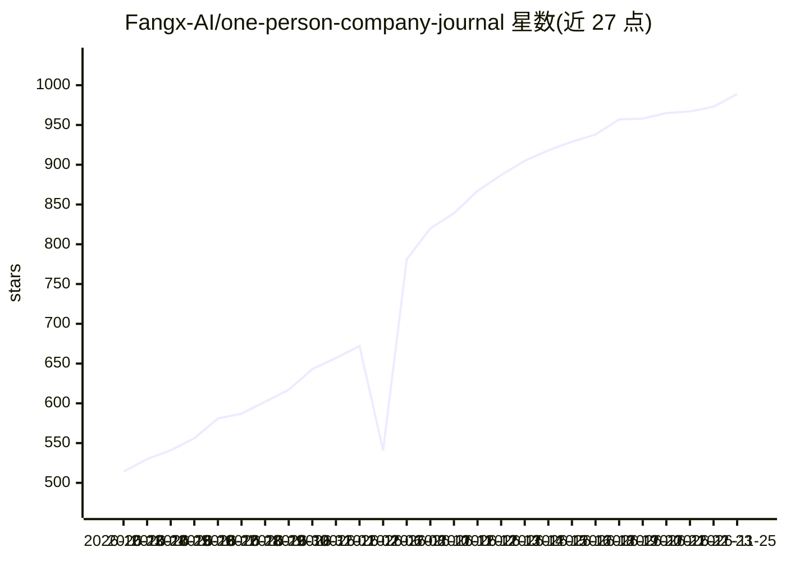

# Fangx-AI/one-person-company-journal

⭐ 989 · JavaScript · NOASSERTION · 推送 2026-11-17 · [GitHub](https://github.com/Fangx-AI/one-person-company-journal) · [官网](https://fxin.cc) · 个人维护 · 中文 README

**记录用 AI 做一人公司的公开日志博客**

一个以 Git 仓库形式托管的中文博客，记录作者从零开始运营一人公司的过程，内容为按日期编号的文章列表（Day 1 至 No.206），主题覆盖产品开发、内容创作、流量、销售、收入与复盘。README 本身主要是文章索引与作者介绍，无安装或运行说明；主题标签含 react、typescript、vite，但 README 未给出构建步骤。文章多为 AI 工具（Codex、DeepSeek、OpenClaw 等）的使用记录与行业观察。

## 筛选速览

| 维度 | 判定 | 备注 |
|---|---|---|
| AI 角色 | `ai-knowledge` | 知识聚合/清单类 |
| 许可风险 | `none` | NOASSERTION |
| 部署形态 | `None` |  |
| 模型依赖 | — | README 未给出锁定关系 |
| 硬件要求 | — | 无带数字的原话,不猜 |
| 安装摩擦 | `low` | 无编译、无系统依赖或容器化 |
| 成熟度 | — | 结构信号不足 |

## 能力要点

- 206 期连载的公开记录，覆盖从 0 到月盈利 1-2 万元的过程
- 文章按期数与时间段（周报/Day/No.）组织成索引
- 内容以 AI 工具实践与一人公司经营复盘为主

## 适用场景

- 想了解用 AI 工具运营一人公司具体过程的读者
- 查找 Codex、OpenClaw 等 AI 工具的个人使用经验记录
- 独立开发者参考产品与内容运营的实践案例

## 场景标签

`教程课程` · 领域:学习与行业

## 证据(README 行号)

> L3: 一个普通人从零开始做一人公司的公开记录。
> L5: 目前已跑到月盈利 1-2 万元，继续记录从 0 到稳定现金流的过程。
> L7: 这里不写成功学，只记录产品、内容、流量、销售、收入、踩坑与复盘。

## 星数曲线

2026-10-23 514 → 2026-11-25 989（+475）

---
*卡片 v1 · prompt 1.4 · 生成 2026-11-24 · 置信度 high · 依据 README sha `4417228c13c2` · [字段定义](../../DATASET.md)*
