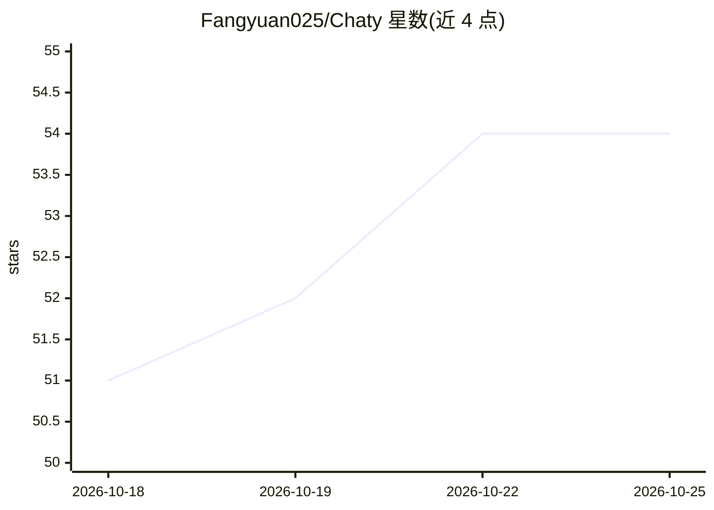

# Fangyuan025/Chaty

⭐ 54 · TypeScript · MIT · 推送 2026-10-23 · [GitHub](https://github.com/Fangyuan025/Chaty) · [官网](https://chaty.ca) · 个人维护 · 中文 README

**本地开源模型桌面应用：聊天/编码代理/文生图/文生音乐/文档问答/语音**

面向终端用户的私有桌面应用，在用户本机运行开源模型，提供六类功能：聊天（流式渲染、思考力度调节）、面向小模型的编码代理（任务计划、差异编辑、命令审批、MCP 工具）、文生图（stable-diffusion.cpp）、文生音乐（audio.cpp）、本地文档检索问答与语音对话（Whisper + 本地语音）。运行时为 llama.cpp（GGUF，Metal/Vulkan）与 Apple Silicon 上的 MLX，应用内搜索下载 Hugging Face 模型。无账户、无云端、无遥测；提供 macOS/Windows/Linux 安装包，macOS 版未公证需手动清除隔离属性，Linux AppImage 为 Beta。

## 筛选速览

| 维度 | 判定 | 备注 |
|---|---|---|
| AI 角色 | `ai-native` | 本体是模型或模型工具 |
| 许可风险 | `permissive` | MIT |
| 部署形态 | `desktop` | 安装包/桌面程序 |
| 模型依赖 | local-ok | 支持本地模型 |
| 硬件要求 | — | 无带数字的原话,不猜 |
| 安装摩擦 | `low` | 无编译、无系统依赖或容器化 |
| 成熟度 | `idea` | |

## 能力要点

- GGUF 经 llama.cpp（Metal/Vulkan）与 Apple Silicon 原生 MLX 双引擎运行
- 面向小模型的编码代理：按模型自带模板做工具调用、编辑即时校验、失败步骤纠正
- 文生图（Z-Image/Qwen-Image/FLUX 等）与文生音乐（YuE2/ACE-Step 等）本地运行
- 本地文档索引检索并引用出处，语音模式含 Whisper 听写与本地朗读

## 适用场景

- 在个人电脑上离线使用本地模型聊天、写代码和生成图片音乐
- 让自己的 PDF、Word 等文档建立本地知识库并获得带引用的回答
- 无账户、无遥测的私有 AI 桌面工作环境

## 场景标签

`聊天机器人` `编码 Agent` `图像生成` `文档问答` · 领域:编码与开发

## 证据(README 行号)

> L10: on open models running entirely on your own Mac or PC. No account, no cloud, no telemetry.
> L27: - **One app, six jobs.** Chat, a coding agent, an image studio, a music studio, answers from your own documents, an

## 星数曲线

2026-10-18 51 → 2026-10-25 54（+3）

---
*卡片 v1 · prompt 1.4 · 生成 2026-10-24 · 置信度 mid · 依据 README sha `b1cbb857e735` · [字段定义](../../DATASET.md)*
