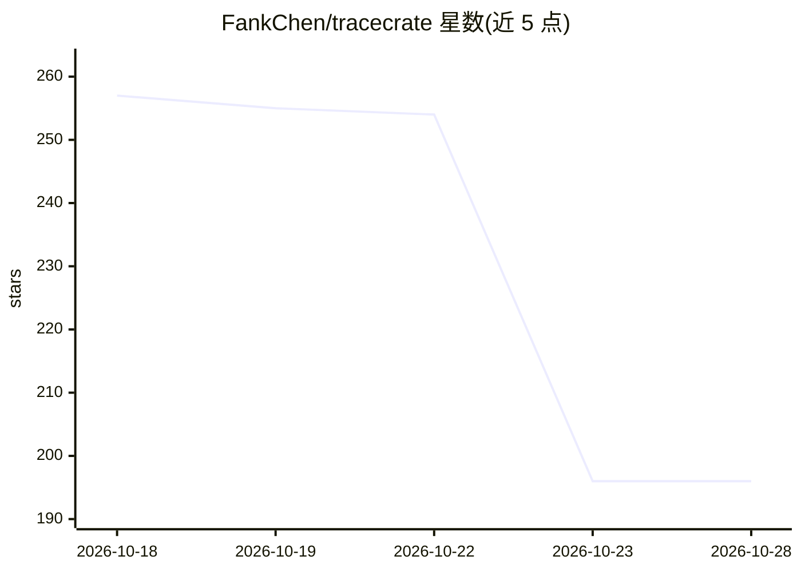

# FankChen/tracecrate

⭐ 196 · TypeScript · MIT · 推送 2026-10-22 · [GitHub](https://github.com/FankChen/tracecrate) · [官网](https://fankchen.github.io/tracecrate/) · 个人维护 · 中文 README

**本地优先的 AI agent 追踪查看台：检视与比对 Claude Code/Codex/OTLP 日志**

纯客户端的 AI 追踪工作台：读取用户显式选择的 Claude Code、Codex 与 OTLP JSON 追踪文件，在浏览器内解析为可搜索的时间线、记录指标、启发式诊断与双会话逐事件比对，并支持导出默认仅结构的隐私受限报告（JSON/HTML）。无后端、无遥测、无 API key，不运行 agent 也不执行记录的命令。格式支持为子集而非通用摄取（单文件 20 MiB、2 万条记录等上限），面向需要本地检查 agent 会话记录的开发者。

## 筛选速览

| 维度 | 判定 | 备注 |
|---|---|---|
| AI 角色 | `ai-ecosystem` | LLM/agent 周边工具 |
| 许可风险 | `permissive` | MIT |
| 部署形态 | `None` |  |
| 模型依赖 | — | README 未给出锁定关系 |
| 硬件要求 | — | 无带数字的原话,不猜 |
| 安装摩擦 | `low` | 无编译、无系统依赖或容器化 |
| 成熟度 | — | 结构信号不足 |

## 能力要点

- 支持 Claude Code / Codex / OTLP JSON 追踪格式的子集读取与解析
- 双会话逐事件比对（指标差 B−A、工具调用计数、字段对齐）
- 默认仅结构的导出（严格允许列表，可选去除时间与 token）
- Web Workers 内本地解析，无后端/遥测/API key

## 适用场景

- 离线检查 Claude Code 或 Codex 会话记录里发生了什么
- 比对两次运行的指标差异与工具调用情况
- 导出脱敏后的结构报告用于分享或复盘

## 场景标签

`LLM 可观测性` · 领域:评测与运维

## 证据(README 行号)

> L3: **A privacy-first, client-side AI trace workbench. Inspect the sequence, question the patterns, share deliberately.*
> L15: TraceCrate turns files you choose into a searchable timeline, recorded metrics, heuristic diagnostics, and side-by-

## 星数曲线

2026-10-18 257 → 2026-10-28 196（-61）

---
*卡片 v1 · prompt 1.4 · 生成 2026-10-22 · 置信度 high · 依据 README sha `cbb6159e062d` · [字段定义](../../DATASET.md)*
