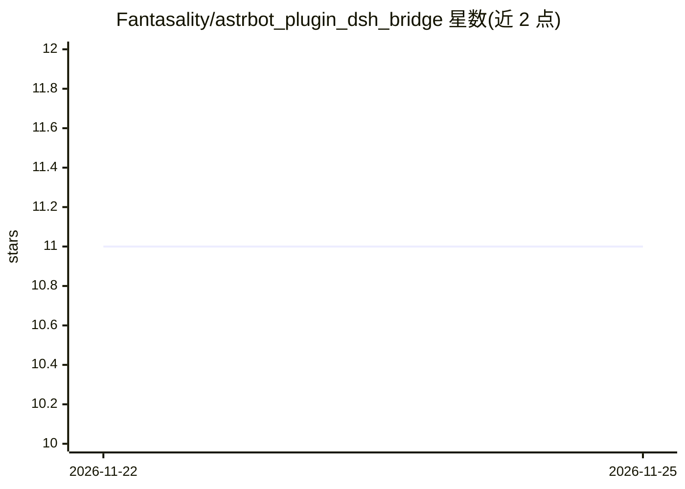

# Fantasality/astrbot_plugin_dsh_bridge

⭐ 11 · Python · MIT · 推送 2026-08-15 · [GitHub](https://github.com/Fantasality/astrbot_plugin_dsh_bridge) · 个人维护 · 中文 README

**让 AstrBot 智能体调用本机 DeepSeek Harness 智能体的桥接插件**

AstrBot 插件，为主智能体提供 `dsh_ask`/`dsh_ping` 两个函数工具，通过 HTTP/JSON 调用本机或局域网内运行的 DeepSeek Harness（DSH）智能体并取回最终回复；通过端口扫描自动发现 DSH Web 服务（默认 59934），并经 `on_llm_request` 钩子向主智能体系统提示词注入使用说明。仅依赖 Python 标准库与 aiohttp；DSH 本地 API 无鉴权且仅绑定回环地址，README 提示勿暴露公网。

## 筛选速览

| 维度 | 判定 | 备注 |
|---|---|---|
| AI 角色 | `ai-ecosystem` | LLM/agent 周边工具 |
| 许可风险 | `permissive` | MIT |
| 部署形态 | `None` |  |
| 模型依赖 | — | README 未给出锁定关系 |
| 硬件要求 | — | 无带数字的原话,不猜 |
| 安装摩擦 | `low` | 无编译、无系统依赖或容器化 |
| 成熟度 | — | 结构信号不足 |

## 能力要点

- 自动扫描回环端口发现 DSH Web 服务，DSH 侧无需安装任何东西
- 提供 /dsh 命令组（help/ping/status/scan/ask/session）与 LLM 工具调用两种方式
- 支持 Windows/Linux/macOS/Docker 及跨设备局域网 IP 配置
- 任务超时自动取消、返回文本截断防上下文溢出

## 适用场景

- 在聊天平台里让 AstrBot 主智能体把任务转交给电脑上的 DSH 智能体执行
- 管理员通过 /dsh ask 让本机智能体执行脚本、整理文件等任务
- AstrBot 部署在服务器/Docker、DSH 在台式机的跨设备联动

## 场景标签

`聊天机器人` `Agent 框架` · 领域:Agent 开发

## 证据(README 行号)

> L3: 让 **AstrBot 的智能体可以直接操纵 DeepSeek Harness（DSH）的智能体**：
> L5: - AstrBot 主智能体获得两个函数工具 —— `dsh_ask`（把任务投递给 DSH 智能体并取回最终回复）和 `dsh_ping`（连通性检测）；
> L111: > 该 API 仅绑定回环地址且无鉴权，因此插件无需任何密钥即可驱动本机 DSH。

## 星数曲线

2026-11-22 11 → 2026-11-25 11（+0）

---
*卡片 v1 · prompt 1.4 · 生成 2026-11-22 · 置信度 high · 依据 README sha `a48e04e5d4e9` · [字段定义](../../DATASET.md)*
