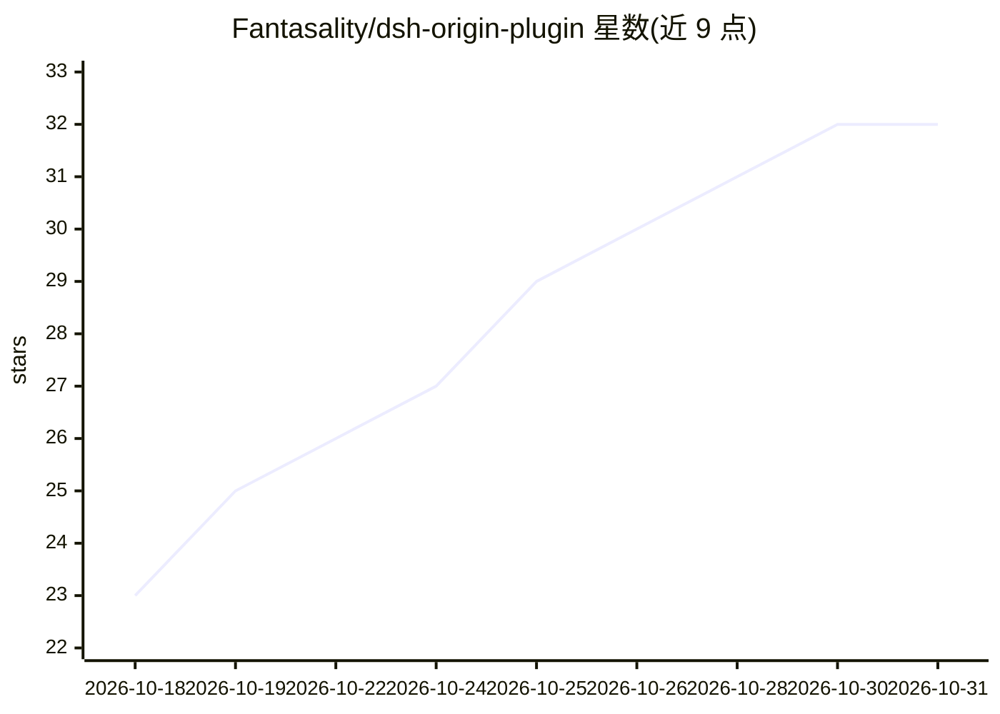

# Fantasality/dsh-origin-plugin

⭐ 32 · Python · MIT · 推送 2026-10-17 · [GitHub](https://github.com/Fantasality/dsh-origin-plugin) · 个人维护 · 中文 README

**通过 MCP 让 AI 对话驱动本机 OriginLab Origin 科学绘图**

面向科研用户与 DSH/MCP 生态开发者的插件：以纯本机 COM 通道连接已安装的 Origin，向 AI 对话客户端暴露 74 个工具，覆盖 2D/3D 绘图、拟合、统计批（t 检验/ANOVA/PCA/生存分析）、矩阵工具、细粒度改图与可编辑 OPJU 工程交付。提供计划确认流（plan_hash 防陈旧）、系统自检、三级导出回退链与稳定错误码。限制：仅 Windows + Origin 2021+，依赖本地安装的 Origin。

## 筛选速览

| 维度 | 判定 | 备注 |
|---|---|---|
| AI 角色 | `ai-ecosystem` | LLM/agent 周边工具 |
| 许可风险 | `permissive` | MIT |
| 部署形态 | `desktop` | 安装包/桌面程序 |
| 模型依赖 | locked-api |  |
| 硬件要求 | — | 无带数字的原话,不猜 |
| 安装摩擦 | `low` | 无编译、无系统依赖或容器化 |
| 成熟度 | — | 结构信号不足 |

## 能力要点

- 74 个 MCP 工具覆盖绘图、拟合、统计、改图与 OPJU 工程交付
- 纯本机 COM 通道，数据不出本机、无外网依赖
- 计划确认流（plan_hash 防陈旧）+ 确定性反读校验（origin_verify_graph）
- 双形态接入：DSH 内官方 dsh-mcp-client 桥接，或任意标准 MCP stdio 客户端

## 适用场景

- 在 AI 对话里用自然语言画 Origin 科研图并导出 PNG/SVG
- 产出可继续手动编辑的 OPJU 工程与可复现 FigureSpec 配置
- 对实验数据做 t 检验、ANOVA、PCA 等统计分析并出图

## 场景标签

`科研工具` · 领域:学习与行业

## 证据(README 行号)

> L51: - 🔌 **双形态接入**：DSH 内经官方 `@deepseek-ai/dsh-mcp-client` 桥接为原生工具；DSH 外经 **`origin_mcp_stdio.py`** 接入任何标准 MCP 客户端（Kimi C
> L28: 13 种 MCP 客户端 + 豆包/Cherry Studio/通义灵码等 UI 型客户端 · **纯本机 COM 通道，

## 星数曲线

2026-10-18 23 → 2026-10-31 32（+9）

---
*卡片 v1 · prompt 1.4 · 生成 2026-10-26 · 置信度 mid · 依据 README sha `f2fcd6f0857a` · [字段定义](../../DATASET.md)*
